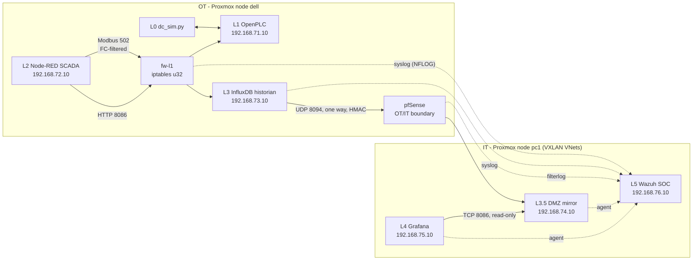

# Data Centre OT Security Lab


A hands-on **OT/ICS security lab** built on a two-node Proxmox cluster. It simulates the HVAC system of a small data centre (Admin room, Reception, Server room) across the full Purdue model: a physics simulator, a real PLC runtime, a SCADA/HMI, an OT historian, a one-way UDP "data diode" into a DMZ, an IT dashboard and a Wazuh SOC with custom OT detections.

> **Lab use only.** Run it on an isolated network. See [SECURITY.md](SECURITY.md).

## What it demonstrates

- **Modbus deep packet inspection** with plain `iptables` (`u32` match, after Nivethan & Papa, 2016): dangerous function codes (FC08 diagnostics, FC17, FC43) are dropped between SCADA and PLC, while normal reads and writes pass.
- **A process-safety interlock** in the PLC that overrides an operator who switches the server-room cooling off.
- **One-way OT to IT replication** over UDP through pfSense with stateless rules, sequence numbers and an HMAC, with link-reliability evidence on the IT dashboard.
- **OT-aware detection engineering** in Wazuh: custom decoders and rules for Modbus blocks, zone violations, attempts to use the diode the wrong way, forged datagrams and link loss, collected without ever sending traffic back into OT.

## Architecture

| Purdue level | Component | Host |
|---|---|---|
| L0 | Python process simulator (24-minute day, thermal model) | LXC `debian-L0-1` |
| L1 | OpenPLC v3 runtime, Structured Text control program | LXC `debian-L0-1` |
| L1/L2 boundary | iptables Modbus DPI firewall and router | LXC `fw-l1` |
| L2 | Node-RED SCADA/HMI (Dashboard 2.0) | LXC `debian-L2` |
| L3 | InfluxDB 2.x historian | LXC `influx-l3` |
| L3.5 | pfSense VM, DMZ historian mirror, UDP one-way link | VM + LXC `mirror-dmz` |
| L4 | Grafana IT dashboard (reads the mirror only) | LXC `grafana-it` |
| L5 | Wazuh SOC (manager, indexer, dashboard) | VM `wazuh-soc` |



OT hosts only ever **send** to IT (UDP data and UDP syslog). Agents run only on IT-side hosts.

## Project status

| Level | Status |
|---|---|
| L0 to L4 | Built and verified in the lab |
| L5 Wazuh | Built. Modbus-block and pfSense detections confirmed with live events; diode, Grafana and pfSense-login rules validated offline |
| Next | Auto-start units for the simulator and firewall, Suricata/Zeek with a Modbus parser, a Kali attacker VM |

## Getting started

The full step-by-step guide, including the scenario, register maps, firewall design, SOC design, demo walkthrough and troubleshooting, is in **[docs/GUIDE.md](docs/GUIDE.md)**.

Requirements: Proxmox VE 8 (one node works; two nodes are used here), a Debian 12 LXC template, a pfSense ISO, Ubuntu Server 24.04 for Wazuh, and about 16 GB of RAM in total.

| Build order | Guide |
|---|---|
| Proxmox bridges and host modules | [Steps 1-3](docs/GUIDE.md#step-1-proxmox-bridges) |
| Simulator, OpenPLC, PLC program | [Steps 4-6](docs/GUIDE.md#step-4-l0-install-the-simulator-in-debian-l0-1) |
| Modbus firewall | [Step 7](docs/GUIDE.md#step-7-firewall-container-in-fw-l1) |
| SCADA and historian | [Steps 8-11](docs/GUIDE.md#step-8-l2-install-node-red-in-debian-l2) |
| SDN, pfSense, DMZ mirror, one-way link | [Steps 12-15](docs/GUIDE.md#step-12-two-node-sdn-the-vxlan-zone-and-vnets-proxmox) |
| Grafana IT dashboard | [Step 16](docs/GUIDE.md#step-16-l4-the-it-dashboard-grafana-on-pc1) |
| Wazuh SOC, log forwarding, decoders and rules | [Steps 17-19](docs/GUIDE.md#step-17-l5-the-wazuh-soc-vm-on-pc1) |
| Time synchronisation | [Step 20](docs/GUIDE.md#step-20-time-synchronisation-and-time-zones) |

## Repository layout

```
.
├── README.md
├── LICENSE
├── SECURITY.md
├── docs/
│   └── GUIDE.md                    full build guide and reference
├── sim/
│   └── dc_sim.py                   L0 process simulator (Modbus slave, pymodbus 3.11+)
├── plc/
│   └── dc_ctrl.st                  L1 OpenPLC program (Structured Text)
├── firewall/
│   └── fw_ot.sh                    fw-l1: Modbus DPI + zone conduits, NFLOG logging
├── scada/
│   └── dc_scada_flow.json          L2 Node-RED flow (HMI, firewall demo, historian writer)
├── historian/
│   └── setup_influx.sh             InfluxDB 2.x install, org, bucket and tokens
├── diode/
│   ├── diode_send.py               one-way UDP sender (OT historian)
│   ├── diode_recv.py               one-way UDP receiver (DMZ mirror)
│   ├── systemd/                    diode-send.service, diode-recv.service
│   └── env/                        send.env.example, recv.env.example
├── network/
│   └── dmz-route.service           OT routes to the DMZ and SOC through pfSense
├── grafana/
│   ├── setup_grafana.sh            L4 Grafana install and provisioning
│   └── dc_it_dashboard.json        IT dashboard incl. one-way link health
├── wazuh/
│   ├── setup_log_forwarding.sh     per-host log forwarding (fw-l1, historian, mirror, grafana)
│   ├── ot_lab_decoders.xml         custom decoders
│   └── ot_lab_rules.xml            custom rules 100100-100599
└── tests/
    └── mbtest.py                   raw Modbus firewall test client
```

## Detections at a glance

| Rule | Level | Detects |
|---|---|---|
| 100101 / 100105 | 10 / 12 | Dangerous Modbus function code from the HMI / Modbus from an unauthorised host |
| 100102 | 13 | Burst of blocked Modbus requests (possible attack on the PLC) |
| 100200 / 100210 | 11 / 13 | TCP from OT into the DMZ: attempt to use the one-way link backwards |
| 100201 / 100202 | 12 / 10 | DMZ or IT host trying to reach OT |
| 100401 | 12 | Forged or malformed datagram at the diode receiver |
| 100402 / 100403 | 8 / 11 | Loss on the one-way link |

The full rule map is in [docs/GUIDE.md](docs/GUIDE.md#69-soc-detections-wazuh-rule-map).

## References

- J. Nivethan and M. Papa, "On the use of open-source firewalls in ICS/SCADA systems," *Information Security Journal: A Global Perspective*, 2016. DOI: [10.1080/19393555.2016.1172283](https://doi.org/10.1080/19393555.2016.1172283)
- [OpenPLC v3](https://github.com/thiagoralves/OpenPLC_v3) · [Node-RED](https://nodered.org) · [InfluxDB](https://docs.influxdata.com/influxdb/v2/) · [pfSense](https://docs.netgate.com/pfsense/) · [Grafana](https://grafana.com/docs/) · [Wazuh](https://documentation.wazuh.com/4.14/)

## License

[MIT](LICENSE)
