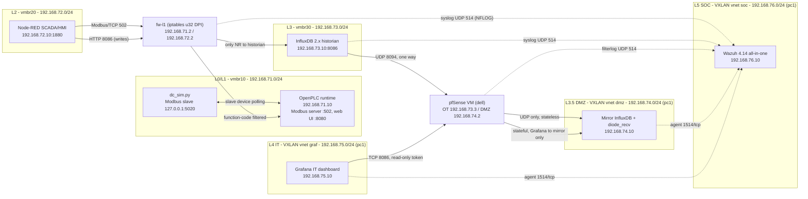
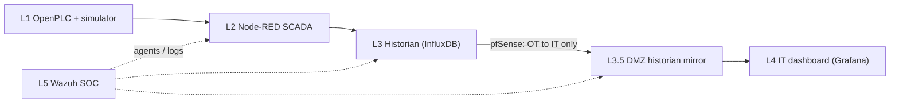

# Build guide: Data Centre OT Security Lab

A hands-on, containerised **OT/ICS security lab** that simulates a small data centre (Admin room, Reception, Server room) running a 24-minute "day". A simulated physical process is controlled by a real PLC runtime (OpenPLC), supervised by a Node-RED SCADA/HMI, recorded by an InfluxDB historian, replicated one-way through pfSense to a DMZ mirror over UDP, shown on an IT-side Grafana dashboard, and protected by a Linux **iptables firewall that inspects Modbus/TCP function codes** (deep packet inspection using the `u32` match, after Nivethan & Papa, 2016).

> **Status:** all levels L0 to L5 are built across two Proxmox nodes: simulator, PLC, SCADA, historian, pfSense, DMZ mirror with a one-way UDP link, the Grafana IT dashboard, and a Wazuh SOC with custom OT decoders and rules. Some SOC detections are confirmed in the lab and others are validated offline only; see [Project status](#2-project-status) and [Roadmap](#13-roadmap).

---

## Table of contents

1. [Scenario overview](#1-scenario-overview)
2. [Project status](#2-project-status)
3. [Architecture](#3-architecture)
4. [Prerequisites](#4-prerequisites)
5. [Step-by-step build guide](#5-step-by-step-build-guide)
6. [PLC and register mapping](#6-plc-and-register-mapping)
7. [The Modbus firewall explained](#7-the-modbus-firewall-explained)
8. [Testing and demo walkthrough](#8-testing-and-demo-walkthrough)
9. [Source files](#9-source-files)
10. [Troubleshooting](#10-troubleshooting)
11. [Security notes and known limitations](#11-security-notes-and-known-limitations)
12. [Repository layout](#12-repository-layout)
13. [Roadmap](#13-roadmap)
14. [References](#14-references)

---

## 1. Scenario overview

### 1.1 The story

A small data centre has three rooms, each with its own air conditioning (HVAC):

| Room | Role | Office-hours load (09:00-18:00) | After-hours load |
|---|---|---|---|
| Admin | Staff offices | 8 kW | 1 kW |
| Reception | Front desk | 4 kW | 0.5 kW |
| Server | IT equipment (critical) | 40 kW | 16 kW |

The server room must stay cool at all times. A PLC reads the room temperatures, decides how the HVAC should behave, and publishes the data to a SCADA system where an operator can watch the plant and, for the server room only, take manual control.

The security question the lab explores: **what happens if someone can send arbitrary Modbus commands to the PLC?** Modbus has no authentication, so any host that can reach TCP port 502 can read data, write setpoints, or send diagnostic commands that disable the device. A network firewall that understands Modbus can allow the legitimate operator commands and drop the dangerous ones.

### 1.2 Time compression

**1 real second = 1 simulated minute**, so a full day takes **24 real minutes**. Changes that would take hours happen in seconds, which makes demonstrations practical.

### 1.3 The simulated day

Outside temperature (simulated weather):

| Simulated time | Outside temperature |
|---|---|
| 00:00 - 06:00 | constant 20 °C |
| 06:00 - 12:00 | rises linearly 20 °C to 35 °C |
| 12:00 - 18:00 | constant 35 °C |
| 18:00 - 24:00 | falls linearly 35 °C to 20 °C |

Electrical load follows office hours: full load from 09:00 to 18:00, minimal load otherwise (table above). Every load carries about 1-3 % noise.

### 1.4 Thermal model (what the simulator computes)

Each room is a lumped heat balance, integrated in small time steps:

```
C · dT/dt = Q_load + UA · (T_out − T_room) − Q_cool
```

| Symbol | Meaning |
|---|---|
| `C` | Thermal capacity of the room (kJ/K) |
| `Q_load` | Heat released by the room load (kW). All electricity becomes heat. |
| `UA` | Heat leaking through the building envelope (kW/K) |
| `Q_cool` | Heat removed by the HVAC (kW) |

The HVAC controller is proportional: it delivers full cooling at +3 K above the setpoint and nothing at or below the setpoint. Electrical power for cooling is `Q_cool / COP`, with COP = 3. Total facility power is the sum of room loads plus HVAC electrical power.

| Room | Setpoint | C (kJ/K) | UA (kW/K) | Max cooling (kW) |
|---|---|---|---|---|
| Admin | 24 °C | 600 | 0.30 | 12 |
| Reception | 24 °C | 400 | 0.50 | 8 |
| Server | 22 °C | 2000 | 0.40 | 60 |

### 1.5 What the PLC does

- Reads simulator values every 100 ms (through Modbus slave-device polling).
- Sets the **Admin and Reception** setpoint to 24 °C in office hours and 28 °C (setback) after hours.
- Keeps the **server room** at 22 °C in automatic mode.
- Raises alarms: **warning** above 28 °C, **critical** above 32 °C in the server room.
- Offers a **manual override** for the server room (SCADA writes a mode, an HVAC enable and a setpoint). The PLC clamps the commanded setpoint to 18.0-30.0 °C.
- Applies a **safety interlock**: above 32 °C it forces the server HVAC on and the setpoint back to 22 °C, whatever the operator asked. It releases below 28 °C (hysteresis avoids chatter).
- Publishes everything to its own Modbus server (port 502) for the SCADA system.

### 1.6 What the SCADA / HMI does

Node-RED polls the PLC once a second and serves two dashboard pages.

- **Data Centre page:** live gauges, a temperature chart, power and cooling readings, HVAC status, safety interlock state, PLC link status, and the server-room manual controls (manual mode, HVAC enable, setpoint slider).
- **Firewall demo page:** buttons that send single raw Modbus requests from the HMI host to the PLC and show whether the PLC replied or the packet was dropped.

### 1.7 The security demonstration

The firewall sits between the SCADA network (L2) and the PLC network (L1). Its policy:

| Traffic | Policy |
|---|---|
| Reads (function codes 1-4) from the HMI | Allowed |
| Writes (function codes 5, 6, 15, 16) from the HMI | Allowed |
| FC 08 sub-function 0001 (restart communications) | **Blocked** |
| FC 08 sub-function 0004 (force listen-only mode) | **Blocked** |
| FC 08 sub-function 000A (clear counters and diagnostics) | **Blocked** |
| FC 17 (report slave ID) | **Blocked** |
| FC 43 (read device identification) | **Blocked** |
| Any other source host | **Blocked entirely** (no TCP handshake) |

The blocked commands are the attacks listed in the reference paper: they can restart the PLC, silence it, wipe its diagnostics, or fingerprint it. The point of the demo is that **even the authorised HMI host cannot send them**. If the HMI is compromised, the damage is limited to what the policy permits.

A second, independent layer is the PLC's own logic (clamping and the safety interlock): even a permitted write cannot push the server room into an unsafe state without the PLC pushing back.

**Suggested demo flow:** run the probe buttons with the firewall off (the dangerous commands succeed), enable the firewall (they are dropped), then use the manual-mode controls to switch the server HVAC off and watch the alarm and the interlock react.

---

## 2. Project status

| Level | Component | Status |
|---|---|---|
| L0 | Python process simulator (`dc_sim.py`) | Built |
| L1 | OpenPLC runtime and control program (`dc_ctrl.st`) | Built |
| Boundary L1/L2 | iptables Modbus DPI firewall (`fw_ot.sh`) | Built and verified in the lab (rules load, SCADA polling passes, `mbtest.py` blocks the dangerous function codes) |
| L2 | Node-RED SCADA/HMI and firewall demo page | Built |
| L3 | InfluxDB 2.x historian (`setup_influx.sh`) and Node-RED historian writer | Built |
| Boundary L2/L3 | Conduit on `fw-l1`: Node-RED to historian port 8086 only | Built (in `fw_ot.sh`) |
| L3.5 | pfSense VM, DMZ historian mirror and UDP one-way replication (`diode_send.py`, `diode_recv.py`) | Built and verified in the lab (mirror receiving data, 0 lost, 0 rejected) |
| L4 | IT dashboard (Grafana, `setup_grafana.sh`, `dc_it_dashboard.json`) with live one-way link health | Built and verified in the lab |
| L5 | Wazuh SOC 4.14 (VM), log forwarding (`setup_log_forwarding.sh`), custom decoders and rules (`ot_lab_decoders.xml`, `ot_lab_rules.xml`) | Built. Confirmed in the lab: fw-l1 Modbus blocks (rules 100101, 100102, 100105) and pfSense `filterlog` blocks (decoder `pf-nohost`, rule 100200). Validated offline only (regex and XML checks): diode, Grafana and pfSense login rules |
| All | Time: hosts on chrony, VMs on PTP-KVM, everything in UTC, dashboards in IST | Built and verified in the lab |

What was verified while building this guide:

- `dc_sim.py` was run and tested against a live Modbus client (pymodbus 3.16.2): reads, setpoint writes and coil writes all take effect.
- `dc_ctrl.st` compiles with OpenPLC's own `matiec` compiler.
- The Node-RED dashboard and the firewall demo probe were tested in a sandbox against stand-in data, for both the "PLC replied" and "no reply" outcomes.
- The Node-RED historian writer was tested against a mock InfluxDB 2 write endpoint: it produces valid line protocol for the right org, bucket and token, and the dashboard's `Historian link` indicator turns `LOST` when the endpoint goes away. A real InfluxDB was not available in the test environment.
- The UDP diode agents were tested locally with simulated packet loss, forged datagrams and a disallowed measurement, and then confirmed in the lab: the mirror's `diode_stats` showed datagrams received with `lost=0`, `rejected=0` and `write_errors=0`.
- Wazuh: the fw-l1 decoder and the Modbus rules were confirmed with `wazuh-logtest` and live alerts; the pfSense decoder was confirmed with live events in **Threat Hunting**. The rule-ordering behaviour described in [section 7.7](#77-the-soc-wazuh) was traced in the Wazuh 4.14.10 source.
- The Modbus firewall rules and the SCADA to PLC path were confirmed working in the lab. The real InfluxDB install and the Modbus write path from the HVAC controls still need confirming on your lab. Use the checks in [section 8](#8-testing-and-demo-walkthrough).

---

## 3. Architecture

### 3.1 Current build (L0-L5)



### 3.2 Target architecture (Purdue-aligned)



### 3.3 Hosts and addressing

| ID | Hostname | Short name in this guide | Type | Node | Bridge | IP address | Role |
|---|---|---|---|---|---|---|---|
| 105 | `Debian-L0-1` | `debian-L0-1` (PLC host) | LXC (Debian 12, unprivileged) | `dell` | `vmbr10` | 192.168.71.10 | Simulator + OpenPLC |
| 107 | `Debian-L2` | `debian-L2` (SCADA) | LXC (Debian 12, unprivileged) | `dell` | `vmbr20` | 192.168.72.10 | Node-RED SCADA/HMI |
| 108 | `Debian-OT-Internal-FW` | `fw-l1` | LXC (Debian 12, unprivileged) | `dell` | `vmbr10` + `vmbr20` + `vmbr30` | 192.168.71.2 / 192.168.72.2 / 192.168.73.2 | Internal OT firewall and router (Modbus DPI, zone conduits) |
| 109 | `Debian-Influx-L3` | `influx-l3` (historian) | LXC (Debian 12, unprivileged) | `dell` | `vmbr30` | 192.168.73.10 | InfluxDB historian and `diode_send.py` |
| 110 | `Pfsense-DMZ-FW` | pfSense | VM (FreeBSD) | `dell` | WAN `vmbr0`, OT `vmbr30`, `dmz`, `graf`, `soc` | OT 192.168.73.3, DMZ/IT/SOC .2 | OT/IT boundary firewall |
| 111 | `mirror-dmz` | `mirror-dmz` | LXC (Debian 12, unprivileged) | `pc1` | VNet `dmz` | 192.168.74.10 | Mirror InfluxDB and `diode_recv.py` |
| 112 | `grafana-it` | `grafana-it` | LXC (Debian 12, unprivileged) | `pc1` | VNet `graf` | 192.168.75.10 | Grafana IT dashboard (reads the mirror only) |
| 113 | `wazuh-soc` | `wazuh-soc` | VM (Ubuntu 24.04) | `pc1` | VNet `soc` | 192.168.76.10 | Wazuh manager, indexer and dashboard (SOC) |
| 100 | `tailscale` | | LXC | | `vmbr0` | management | Remote access (not part of the Purdue model) |
| 106 | `reverse-proxy` | | LXC | | `vmbr0` + `.1` on lab networks | management | Caddy reverse proxy for the web UIs (`*.lab`) |

The guide uses the short names in prose (for example `fw-l1`); the hostname column is what you see in Proxmox and in log lines (`Debian-OT-Internal-FW` appears in the firewall's syslog).

### 3.3.1 Two-node placement and the SDN networks

The lab runs on a two-node Proxmox cluster:

| Node | Role | Guests |
|---|---|---|
| `dell` | OT side | `debian-L0-1`, `fw-l1`, `debian-L2`, `influx-l3`, the pfSense VM |
| `pc1` | IT side | `mirror-dmz`, `grafana-it`, `wazuh-soc`, and later Kali |

pfSense sits on the OT node on purpose, so only DMZ, IT and SOC traffic ever crosses between the nodes and no OT traffic does. The OT bridges (`vmbr10`, `vmbr20`, `vmbr30`) exist on `dell` only. The IT zones are **Proxmox SDN VXLAN VNets**, which exist on both nodes:

| VNet | VNI | Subnet | Hosts | Status |
|---|---|---|---|---|
| `dmz` | 74 | 192.168.74.0/24 | pfSense .2, mirror .10 | Built |
| `graf` | 75 | 192.168.75.0/24 | pfSense .2, Grafana .10, Kali .50 | Built (Grafana) |
| `soc` | 76 | 192.168.76.0/24 | pfSense .2, Wazuh .10 | Built |

**Addressing convention:** in each IT zone `.1` is reserved for the reverse proxy, **pfSense is `.2`** (so it is the gateway of its zone), and services start at `.10`. The pfSense OT-side address is `192.168.73.3`.

The VXLAN tunnels run over your ordinary home LAN between the nodes, so the OT/IT separation across nodes is **logical, not physical**. That is fine for a lab, but say so when you present it.

### 3.4 Design choices

- **LXC for everything that is Linux** (light, fast to rebuild). **VMs** for pfSense (FreeBSD cannot run in LXC), Wazuh (heavy indexer) and Kali.
- **Bridges with no IP on the Proxmox host**, so the host is not part of the OT network.
- **No default route between zones except through the firewall.** Each side has a route to the other zone via the firewall.
- **The simulator and the PLC share a container** (simulator bound to `127.0.0.1`). This keeps L0 and L1 on one host. Split them later by changing one IP if you want to attack the L0/L1 link.

---

## 4. Prerequisites

| Item | Requirement |
|---|---|
| Hypervisor | Proxmox VE (the guide was written for 8.x) |
| Container template | Debian 12 standard LXC template |
| Resources | `debian-L0-1`: 2 vCPU, 1 GB RAM (the OpenPLC build needs it), 8 GB disk. `fw-l1`: 1 vCPU, 512 MB, 4 GB. `debian-L2`: 1-2 vCPU, 1 GB, 8 GB. `influx-l3`: 2 vCPU, 2 GB, 16 GB. `grafana-it`: 2 vCPU, 2 GB, 8 GB (Grafana 13 uses about 1 GB on its own). |
| Internet access | Needed during install only (apt, pip, npm, GitHub). Keep the lab itself isolated afterwards. |
| Software versions used | Debian 12, Python 3.11, pymodbus 3.16.2 (3.11 or later is required by the simulator), OpenPLC v3, Node-RED 5.x with Node.js 22 or 24, Dashboard 2.0, node-red-contrib-modbus, node-red-contrib-influxdb 0.7, InfluxDB 2.x |

> **InfluxDB version:** the lab uses InfluxDB **2.x** because it has a built-in web UI, a simple token model and a plain HTTP write API, and the Node-RED InfluxDB node supports it. InfluxData now lists InfluxDB 3 Core as the latest stable line and treats 2.x as maintenance-only, so plan a migration if you extend this beyond a lab. InfluxDB 3 listens on port 8181 and is not compatible with the 2.x data directory or Flux queries.

> **OpenPLC v3 is archived upstream** (replaced by OpenPLC Runtime v4) and receives no security fixes. This guide uses v3 because its web UI and Modbus slave-device polling are what the lab relies on. That also suits a security lab, but do not expose it to untrusted networks.

---

## 5. Step-by-step build guide

Do the steps in order. Each step ends with a check.

### Step 1. Proxmox bridges

On the Proxmox host, add bridges with **no IP address** (Datacenter > Node > Network, or edit `/etc/network/interfaces`):

```
auto vmbr10
iface vmbr10 inet manual
    bridge-ports none
    bridge-stp off
    bridge-fd 0

auto vmbr20
iface vmbr20 inet manual
    bridge-ports none
    bridge-stp off
    bridge-fd 0

auto vmbr30
iface vmbr30 inet manual
    bridge-ports none
    bridge-stp off
    bridge-fd 0
```

Apply with `ifreload -a`. The bridges have no uplink, so traffic stays inside the lab.

> If you also want to reach the containers from your own computer, give each container a **second management NIC** on your management bridge (for example `vmbr0`) with **no gateway**. Be aware that a management NIC on a lab host is a path that bypasses the firewall (see [section 11](#11-security-notes-and-known-limitations)).

### Step 2. Proxmox host preparation for the firewall

The firewall container shares the host kernel, so the netfilter modules it needs must be loaded on the **host**:

```bash
modprobe xt_u32 nft_compat nf_conntrack xt_conntrack xt_limit xt_LOG nf_log_syslog nfnetlink_log xt_NFLOG xt_hashlimit
printf "xt_u32\nnft_compat\nnf_conntrack\nxt_conntrack\nxt_limit\nxt_LOG\nnf_log_syslog\nnfnetlink_log\nxt_NFLOG\nxt_hashlimit\n" > /etc/modules-load.d/fw-lab.conf
echo "net.netfilter.nf_log_all_netns=1" > /etc/sysctl.d/99-fw-lab.conf
sysctl --system
lsmod | grep -E "xt_u32|nft_compat"
```

`nfnetlink_log` and `xt_NFLOG` let the firewall container log its drops with `NFLOG` to `ulogd2` inside the container, which is what the SOC reads (Step 18). `nf_log_all_netns=1` is only needed if you switch the rules back to `LOG` (kernel log on the host). **Check:** `lsmod` lists `xt_u32`, `nft_compat` and `xt_NFLOG`.

### Step 3. Create the four containers

Find and download the template:

```bash
pveam update
pveam available | grep debian-12
pveam download local debian-12-standard_<version>_amd64.tar.zst
```

Create the containers (replace `<version>`; the IDs and hostnames are the ones used in this lab, see [3.3](#33-hosts-and-addressing)):

```bash
# L0/L1: simulator + OpenPLC
pct create 105 local:vztmpl/debian-12-standard_<version>_amd64.tar.zst \
  --hostname Debian-L0-1 --cores 2 --memory 1024 --swap 0 \
  --rootfs local-lvm:8 --unprivileged 1 --onboot 1 \
  --net0 name=eth0,bridge=vmbr10,ip=192.168.71.10/24,gw=192.168.71.2,firewall=0

# Internal OT firewall between L1, L2 and L3 (no gateway on any NIC)
pct create 108 local:vztmpl/debian-12-standard_<version>_amd64.tar.zst \
  --hostname Debian-OT-Internal-FW --cores 1 --memory 512 --swap 0 \
  --rootfs local-lvm:4 --unprivileged 1 --onboot 1 \
  --net0 name=eth0,bridge=vmbr10,ip=192.168.71.2/24,firewall=0 \
  --net1 name=eth1,bridge=vmbr20,ip=192.168.72.2/24,firewall=0 \
  --net2 name=eth2,bridge=vmbr30,ip=192.168.73.2/24,firewall=0

# L2: Node-RED
pct create 107 local:vztmpl/debian-12-standard_<version>_amd64.tar.zst \
  --hostname Debian-L2 --cores 2 --memory 1024 --swap 0 \
  --rootfs local-lvm:8 --unprivileged 1 --onboot 1 \
  --net0 name=eth0,bridge=vmbr20,ip=192.168.72.10/24,gw=192.168.72.2,firewall=0

# L3: historian
pct create 109 local:vztmpl/debian-12-standard_<version>_amd64.tar.zst \
  --hostname Debian-Influx-L3 --cores 2 --memory 2048 --swap 0 \
  --rootfs local-lvm:16 --unprivileged 1 --onboot 1 \
  --net0 name=eth0,bridge=vmbr30,ip=192.168.73.10/24,gw=192.168.73.2,firewall=0

pct start 108 && pct start 105 && pct start 107 && pct start 109
```

Setting the **gateway of each host to the firewall** provides the routing: `debian-L0-1` reaches the other zones through 192.168.71.2, `debian-L2` through 192.168.72.2, and `influx-l3` through 192.168.73.2. If a host has an extra management NIC, leave that NIC's gateway empty and instead add a static route (see [Troubleshooting](#10-troubleshooting)).

During the installs below the containers need internet access. Temporarily give them a NIC on a bridge with a route out, or install from a template-based image, then remove it.

**Check:** `pct list` shows all four running.

### Step 4. L0: install the simulator (in `debian-L0-1`)

```bash
pct enter 105
apt update && apt install -y python3 python3-venv python3-pip
mkdir -p /opt/dcsim && cd /opt/dcsim
python3 -m venv venv
./venv/bin/pip install pymodbus
```

Copy `sim/dc_sim.py` (listing in [section 9.1](../sim/dc_sim.py)) to `/opt/dcsim/dc_sim.py`.

Run it once in the foreground to confirm it works:

```bash
/opt/dcsim/venv/bin/python /opt/dcsim/dc_sim.py --modbus --host 127.0.0.1 --port 5020
```

You should see a status line every 10 simulated minutes. Stop it with Ctrl-C.

Run it as a service, bound to localhost so it is not exposed on the network. Create `/etc/systemd/system/dcsim.service`:

```ini
[Unit]
Description=Data Centre Simulator
Before=openplc.service
After=network.target

[Service]
ExecStart=/opt/dcsim/venv/bin/python /opt/dcsim/dc_sim.py --modbus --host 127.0.0.1 --port 5020 --quiet
Restart=always
User=nobody

[Install]
WantedBy=multi-user.target
```

```bash
systemctl daemon-reload
systemctl enable --now dcsim
```

**Check:**

```bash
/opt/dcsim/venv/bin/python -c "from pymodbus.client import ModbusTcpClient as C; c=C('127.0.0.1',port=5020); c.connect(); print(c.read_input_registers(0,count=12).registers)"
```

Register 0 is the minute of day, register 1 is the outside temperature x10 (200 at night).

### Step 5. L1: install OpenPLC (in `debian-L0-1`)

```bash
apt install -y git sudo
cd /root
git clone https://github.com/thiagoralves/OpenPLC_v3.git
cd OpenPLC_v3
./install.sh linux
```

The build takes several minutes. The web UI is then on port 8080 with default login `openplc` / `openplc`. **Change the password** (Users page).

> The runtime may use a port other than 8080 depending on your version and settings. If the page does not load, check `ss -tlnp` inside the container.

### Step 6. Load the PLC program

1. In the OpenPLC web UI open **Programs > Upload Program** and choose `plc/dc_ctrl.st` ([listing](../plc/dc_ctrl.st)).
2. Give it a name and click **Upload program**, then **Launch program**. This compiles it.
3. Open **Slave Devices > Add new device** and enter:

| Field | Value |
|---|---|
| Device name | `dcsim` |
| Protocol | Generic Modbus TCP Device |
| Slave ID | 1 |
| IP address / port | `127.0.0.1` / `5020` |
| Discrete inputs | start 0, size 0 |
| Coils | start 0, size **3** |
| Input registers | start 0, size **12** |
| Holding registers - read | start 0, size 0 |
| Holding registers - write | start 0, size **3** |

4. Open **Settings**, enable the Modbus server on port 502, and save.
5. Click **Start PLC** on the left menu.

**Check:** the **Monitoring** page lists every variable with a name, type and live value, and `hmi_minute` advances by about 1 every second.

> If the Monitoring page shows garbled rows, the program file has multiple spaces or trailing comments on declaration lines. See [Troubleshooting](#10-troubleshooting).

Verify the PLC's own Modbus server from the container:

```bash
/opt/dcsim/venv/bin/python -c "from pymodbus.client import ModbusTcpClient as C; c=C('127.0.0.1'); c.connect(); print(c.read_holding_registers(0,count=14).registers, c.read_coils(0,count=7).bits[:7])"
```

### Step 7. Firewall container (in `fw-l1`)

```bash
pct enter 108
apt update
DEBIAN_FRONTEND=noninteractive apt install -y iptables iptables-persistent netcat-openbsd tcpdump
iptables -V        # expect (nf_tables)
echo "net.ipv4.ip_forward=1" > /etc/sysctl.d/99-fw.conf
sysctl -p /etc/sysctl.d/99-fw.conf
cat /proc/sys/net/ipv4/ip_forward   # expect 1
```

Copy `firewall/fw_ot.sh` ([listing](../firewall/fw_ot.sh)) into the container, for example from the Proxmox host:

```bash
pct push 108 /root/fw_ot.sh /root/fw_ot.sh --perms 755
```

Edit the variables at the top of the script if your addresses differ:

```
PLC=192.168.71.10    HMI=192.168.72.10    HIST=192.168.73.10    SOC=192.168.76.10
```

An optional **engineering workstation** gets read-only Modbus access (function codes 1-4, no writes). It is off by default, because an allow rule for an address nobody uses lets anyone who takes that address read the PLC. To use it, put the workstation at `192.168.72.11` and run `ENG=192.168.72.11 /root/fw_ot.sh`. Apply and persist the rules:

```bash
/root/fw_ot.sh
iptables -L FORWARD -n -v --line-numbers
iptables -L MB_FILTER -n -v
iptables -L MB_POLICY -n -v
netfilter-persistent save
```

**Check:** `FORWARD` has policy `DROP`, the `MB_FILTER` and `MB_POLICY` chains are present, two rules mention `8086` (the historian conduit), and the logging rules use `NFLOG`. After a container reboot, confirm the rules came back (`iptables -S | grep MODBUS-BLOCK`); if they did not, run `fw_ot.sh` again and `netfilter-persistent save`. If the script reports an error on a `u32` line, the host module from Step 2 is not loaded.

> The `permission denied on key kernel.pid_max` and `fs.protected_*` messages from `sysctl --system` are harmless inside an unprivileged container.

### Step 8. L2: install Node-RED (in `debian-L2`)

Node-RED 5 needs Node.js 22.9 or later. Use a normal user, not root:

```bash
pct enter 107
apt update && apt install -y curl git build-essential sudo
adduser nr && usermod -aG sudo nr
su - nr
bash <(curl -sL https://github.com/node-red/linux-installers/releases/latest/download/install-update-nodered-deb) --node24
sudo systemctl enable --now nodered
```

Answer `N` to the Raspberry Pi nodes question. The editor is on `http://192.168.72.10:1880`.

In the editor, open **Menu > Manage palette > Install** and install:

- `node-red-contrib-modbus`
- `@flowfuse/node-red-dashboard` (Dashboard 2.0)

Then **Menu > Import**, paste `scada/dc_scada_flow.json` ([listing](../scada/dc_scada_flow.json)) and click **Deploy**.

The flow uses Node's built-in `net` module in the "raw Modbus probe" function node. This needs `functionExternalModules: true` in `~/.node-red/settings.js`, which is the default.

**Check:** `http://192.168.72.10:1880/dashboard/dc` shows live values, and the PLC link indicator says `OK`.

### Step 9. L3: install the historian (in `influx-l3`)

```bash
pct enter 109
# copy setup_influx.sh into the container first (for example with pct push from the Proxmox host)
ADMIN_PASSWORD='choose-a-strong-password' ./setup_influx.sh
```

The script (listing in [section 9.6](../historian/setup_influx.sh)) adds the InfluxData apt repository after checking the signing-key fingerprint, installs `influxdb2` and the CLI, runs the first-time setup (org `lab`, bucket `dc_ot`, 30-day retention), and prints two **least-privilege tokens**: a **write-only** token for Node-RED and a **read-only** token for later use (Grafana, replication). Copy the write token now; it is shown once.

**Check:**

```bash
curl -s http://127.0.0.1:8086/health          # "status":"pass"
influx bucket list                            # dc_ot is listed
```

The web UI is at `http://192.168.73.10:8086` (log in as `admin`). To reach it from your own computer you need a management path into `vmbr30`, such as a second NIC on the container.

### Step 10. Connect Node-RED to the historian (in `debian-L2`)

1. Install the palette node `node-red-contrib-influxdb` (**Menu > Manage palette > Install**).
2. Re-import `scada/dc_scada_flow.json` (delete the old tab first) and **before deploying** double-click the **OT Historian (L3)** configuration node (open it from any `write to historian` node), and paste the **write-only token** into the Token field. The URL is `http://192.168.73.10:8086`, the version is `2.0`, the organisation is `lab` and the bucket is `dc_ot`. The token is stored in Node-RED's credentials store and is not part of the exported flow.
3. Click **Deploy**.

**Check:** on the Data Centre page the **Historian link** reads `OK`. In the InfluxDB UI **Data Explorer**, bucket `dc_ot` shows `dc_temp`, `dc_power` and `dc_state`. From the CLI inside `influx-l3`:

```bash
influx query 'from(bucket:"dc_ot") |> range(start:-2m) |> filter(fn:(r)=> r._measurement=="dc_temp") |> last()'
```

### Step 11. Verify the whole chain

1. On `debian-L2`: `nc -zv 192.168.71.10 502` connects.
2. Run the test client ([`tests/mbtest.py`](../tests/mbtest.py)) from `debian-L2`: `python3 mbtest.py`. All lines should say `PASS`.
3. Confirm the historian conduit: `nc -zv 192.168.73.10 8086` succeeds from `debian-L2`, but fails from `debian-L0-1` (L1 must not reach L3).
4. Open the **Firewall demo** page and press **RUN ALL TESTS**. The first two rows should say `PLC replied`, the remaining five `no reply (dropped)`, all with verdict `OK`.

### Step 12. Two-node SDN: the VXLAN zone and VNets (Proxmox)

Do this once, in the web UI, on either node. Each node must reach the other on **UDP 4789** (allow it if you use the Proxmox firewall). Note both nodes' LAN IP addresses.

1. **Datacenter > SDN > Zones > Add > VXLAN:** ID `labvx` (zone IDs are limited to 8 characters), **Peer address list** = the LAN IPs of both nodes (comma-separated), **MTU** `1450` (VXLAN adds 50 bytes), then Create.
2. **SDN > VNets > Create**, all in zone `labvx`: `dmz` with tag 74, `graf` with tag 75, `soc` with tag 76.
3. **Do not create subnets** on the VNets. Without a subnet Proxmox does not act as gateway, DHCP or IPAM, and the VNet is a plain layer-2 network. pfSense is the gateway.
4. **Datacenter > SDN > Apply.** Nothing exists until you apply. Proxmox then creates bridges named `dmz`, `graf` and `soc` on both nodes.

**Check, on each node:**

```bash
ip -br link | grep -E "^(dmz|graf|soc)"
```

Test across the nodes before building on it: create a throwaway LXC on each node attached to `dmz` (for example `192.168.74.101` and `192.168.74.102`, MTU 1450, no gateway), ping across, and run `ping -M do -s 1400 <other>` to confirm the MTU. Delete the test containers afterwards.

Attaching guests: LXC `--net0 name=eth0,bridge=dmz,ip=192.168.74.10/24,gw=192.168.74.2,mtu=1450,firewall=0`. For VMs choose the VNet as the bridge, model VirtIO, and set MTU to `1` so the NIC inherits the bridge MTU.

> A two-node cluster loses quorum when either node is off, and the surviving node then refuses to start guests. Run `pvecm expected 1` on the survivor, or add a QDevice.

### Step 13. pfSense (VM on `dell`)

Create the VM with NICs on `vmbr0` (WAN, for updates), `vmbr30` (OT side) and the `dmz` VNet. In pfSense:

1. **Interfaces > Assignments:** WAN is the `vmbr0` NIC, LAN is the `vmbr30` NIC (rename its description to **OT**, address `192.168.73.3/24`), and add the `dmz` NIC as **DMZ** with static IPv4 `192.168.74.2/24`, MTU 1450 and no gateway. (Add `graf` and `soc` the same way when you reach L4 and L5.)
2. **Firewall > Rules > OT:** delete the default allow-all rules, but keep the anti-lockout rule so the web UI stays reachable. Add a pass rule: protocol **UDP**, source `192.168.73.10` (the historian), destination `192.168.74.10` (the mirror), destination port `8094`. Under **Advanced options** set **State type: None**. Add a final logged block rule for anything else from OT.
3. **Firewall > Rules > DMZ:** add one logged block rule for any to any. Because the OT pass rule keeps no state, nothing in the DMZ can answer back, which is what makes the link one-way.
4. On the historian, route the DMZ through pfSense (the historian's default gateway is `fw-l1`, which would drop it). Make it permanent with a systemd unit, because Proxmox regenerates the network file inside containers:

```bash
cat > /etc/systemd/system/dmz-route.service <<'EOF'
[Unit]
Description=Route to DMZ via pfSense
After=network-online.target
Wants=network-online.target

[Service]
Type=oneshot
ExecStart=/sbin/ip route replace 192.168.74.0/24 via 192.168.73.3
RemainAfterExit=yes

[Install]
WantedBy=multi-user.target
EOF
systemctl daemon-reload && systemctl enable --now dmz-route
ip route get 192.168.74.10        # via 192.168.73.3
```

**Reaching the pfSense web UI through a reverse proxy:** pfSense serves HTTPS only and marks its login cookie `Secure`, so the proxy must serve HTTPS too. A Caddyfile that works:

```
pfsense.lab {
    tls internal
    reverse_proxy https://192.168.73.3 {
        transport http {
            tls_insecure_skip_verify
        }
    }
}
```

Also add `pfsense.lab` under **System > Advanced > Admin Access > Alternate Hostnames**. (InfluxDB, in contrast, is plain HTTP: proxy it with `reverse_proxy 192.168.73.10:8086`, no `https://`.)

### Step 14. The DMZ mirror and the diode agents

**Mirror host (on `pc1`).** Create an LXC `mirror-dmz` (ID 111) on the `dmz` VNet (`192.168.74.10/24`, gateway `192.168.74.2`, MTU 1450, 2 vCPU, 2 GB, 16 GB). Give it a temporary second NIC on `vmbr0` for the install and remove it afterwards. Run `setup_influx.sh` inside it, and keep both tokens: the **write** token is for the receiver and the **read** token is for Grafana later.

**Receiver (in `mirror-dmz`).** Put `diode_recv.py` ([listing](../diode/diode_recv.py)) in `/opt/diode/` and create `/etc/diode/recv.env` with `chmod 600`:

```
DIODE_LISTEN=0.0.0.0:8094
DIODE_KEY=<long random string>
MIRROR_URL=http://127.0.0.1:8086
MIRROR_ORG=lab
MIRROR_BUCKET=dc_ot
MIRROR_TOKEN=<mirror write token>
```

`/etc/systemd/system/diode-recv.service`:

```ini
[Unit]
Description=Diode UDP receiver
After=network.target influxdb.service

[Service]
EnvironmentFile=/etc/diode/recv.env
ExecStart=/usr/bin/python3 /opt/diode/diode_recv.py
Restart=always
User=nobody

[Install]
WantedBy=multi-user.target
```

**Sender (in `influx-l3`).** Put `diode_send.py` ([listing](../diode/diode_send.py)) in `/opt/diode/` and create `/etc/diode/send.env` with `chmod 600`:

```
INFLUX_URL=http://127.0.0.1:8086
INFLUX_ORG=lab
INFLUX_BUCKET=dc_ot
INFLUX_TOKEN=<historian READ-only token>
DIODE_TARGET=192.168.74.10:8094
DIODE_KEY=<the same key>
DIODE_INTERVAL=5
```

`/etc/systemd/system/diode-send.service` is the same as the receiver's unit but with `send.env`, `diode_send.py` and one extra line, `StateDirectory=diode`, under `[Service]`. Make `/opt/diode` and the scripts readable by the service user (`chmod 755 /opt/diode; chmod 644 /opt/diode/*.py`). Enable both services with `systemctl daemon-reload && systemctl enable --now diode-recv` (and `diode-send`).

**Check:** on the mirror, ask the database rather than the journal (the receiver is deliberately quiet):

```bash
influx query 'from(bucket:"dc_ot") |> range(start:-2m) |> filter(fn:(r)=> r._measurement=="diode_stats") |> last()'
```

You should see `received`, `points` and `last_seq` growing, with `lost`, `rejected` and `write_errors` at 0. The InfluxDB UI **Data Explorer** shows `dc_temp`, `dc_power` and `dc_state` in the mirror's `dc_ot` bucket.

### Step 15. Verify the one-way behaviour

| Test | Expected |
|---|---|
| `nc -zv -w3 192.168.74.10 8086` from the historian | Times out (TCP blocked). pfSense **Status > System Logs > Firewall** shows the block. |
| `nc -zv -w3 192.168.73.10 8086` from the mirror | Times out |
| Disable the UDP pass rule on pfSense for 30 s, then re-enable | Data stops, `lost` rises by about 6 datagrams, and the gap stays (no backfill) |
| On the mirror: `printf '#DIODE v1 seq=1 ts=1 n=0 crc=00000000 mac=-\n' \| nc -u -w1 127.0.0.1 8094` | Receiver logs `REJECTED ... bad mac` and `rejected` rises |

### Step 16. L4: the IT dashboard (Grafana on `pc1`)

**pfSense.** Add the `graf` NIC to the pfSense VM, then in pfSense assign it as **GRAF** with static IPv4 `192.168.75.2/24` and MTU 1450. Rules on **GRAF**: a pass rule for protocol **TCP**, source `192.168.75.10`, destination `192.168.74.10`, port `8086` (normal stateful rule), then a logged block rule for everything else. The existing DMZ block-all rule does not affect the replies, because the connection is opened from GRAF and tracked by state. Do not add any rule from GRAF toward OT.

**Grafana container (on `pc1`).**

```bash
pct create 112 local:vztmpl/debian-12-standard_<version>_amd64.tar.zst \
  --hostname grafana-it --cores 2 --memory 2048 --swap 0 \
  --rootfs local-lvm:8 --unprivileged 1 --onboot 1 \
  --net0 name=eth0,bridge=graf,ip=192.168.75.10/24,mtu=1450,firewall=0 \
  --net1 name=eth1,bridge=vmbr0,ip=dhcp,firewall=0
pct start 112
```

The temporary `net1` (on pc1's `vmbr0`) provides internet for the install, and `net0` has no gateway yet so there is no clash between two default routes. After the install, remove it and set the gateway:

```bash
pct set 112 --delete net1
pct set 112 --net0 name=eth0,bridge=graf,ip=192.168.75.10/24,gw=192.168.75.2,mtu=1450,firewall=0
```

**Install and provision.** Copy `grafana/setup_grafana.sh` and `grafana/dc_it_dashboard.json` into the container (same folder) and run:

```bash
MIRROR_READ_TOKEN='<read token printed by setup_influx.sh on the MIRROR>' GRAFANA_ADMIN_PASSWORD='choose-one' ./setup_grafana.sh
```

The script ([listing](../grafana/setup_grafana.sh)) adds the Grafana APT repository, installs Grafana, provisions a data source `DMZ Mirror` (Flux, org `lab`, bucket `dc_ot`, read-only token) and the dashboard, sets that provisioned dashboard as the organisation's home page, and switches off update checks and analytics. It prints the HTTP status of a test query to the mirror: `200` means the network path and the token both work. Grafana's first start takes 30-60 seconds, so port 3000 is not open immediately; the script waits for it. The IT zone has no internet by design, so the script also disables Grafana's start-up plugin downloads (`GF_PLUGINS_PREINSTALL_DISABLED`). Without that setting the log fills with harmless `Failed to install plugin ... grafana.com` errors.

**Reaching the dashboard.** Grafana listens on port 3000. Viewers should come from the management or IT side, not from OT, because an OT host looking at an IT dashboard is the wrong direction for the policy. The simplest way is a **management NIC** on the Grafana container (a second NIC on `vmbr0`, with an address in your management range and no gateway), then point your reverse proxy at it:

```
grafana.lab {
    reverse_proxy <management-ip>:3000
}
```

If the reverse proxy has a NIC on the `graf` VNet at `192.168.75.1`, you do not need a management NIC on Grafana at all: point the proxy at `192.168.75.10:3000` and viewers reach it through the proxy. If you use a proxy hostname, also set `GF_SERVER_ROOT_URL=http://grafana.lab/` in `/etc/default/grafana-server` and restart Grafana. A management NIC is a path outside the pfSense policy, so keep it for viewing and remove it for attack exercises.

**Check:**

| Test | Expected |
|---|---|
| Open the dashboard (**OT Lab > Data Centre - IT view (DMZ mirror)**) | The four temperature gauges, the charts and the state timeline fill in, and **Link status** reads `LIVE` |
| `nc -zv -w3 192.168.74.10 8086` from `grafana-it` | Connects |
| `nc -zv -w3 192.168.73.10 8086` from `grafana-it` | Times out (IT cannot reach the OT historian) |
| `nc -zv -w3 192.168.73.1 22` or any OT address from `grafana-it` | Times out, and pfSense logs the block |

### Step 17. L5: the Wazuh SOC (VM on `pc1`)

**VM.** Ubuntu Server 24.04, 4 vCPU, 8 GB RAM, 50 GB disk, one NIC on the `soc` VNet (VirtIO, MTU `1`). Static address `192.168.76.10/24`, gateway `192.168.76.2`. For the install it needs internet for a short time: either a temporary second NIC on `vmbr0`, or a temporary pfSense rule on **SOC** that passes the VM to the internet (remove it afterwards).

**pfSense.** Add the `soc` NIC to the pfSense VM and assign it as **SOC** with static IPv4 `192.168.76.2/24` and MTU 1450. Then add these rules. Each conduit is the only thing allowed into the SOC from that zone:

| Interface | Pass | Notes |
|---|---|---|
| **OT** | UDP from `192.168.73.2`, `192.168.73.10`, `192.168.71.10` and `192.168.72.10` to `192.168.76.10` port 514 | Syslog from `fw-l1`, the historian, the PLC host and the SCADA host (the last two are routed through `fw-l1`, which keeps their source address). **State type: None**, like the diode rule, so nothing comes back into OT |
| **DMZ** | TCP from `192.168.74.10` to `192.168.76.10` ports 1514, 1515 | Wazuh agent on the mirror. Put it **above** the DMZ block-all rule |
| **GRAF** | TCP from `192.168.75.10` to `192.168.76.10` ports 1514, 1515 | Wazuh agent on Grafana |
| **SOC** | nothing | The SOC never initiates connections (rule 100203 alerts if it tries) |

pfSense's own logs: **Status > System Logs > Settings**, tick **Log packets matched from the default block rules**, enable **Remote Logging**, server `192.168.76.10:514`, contents **Firewall Events** (add **System Events** for logins). These arrive from pfSense's SOC address, `192.168.76.2`.

**Routes from OT to the SOC.** The historian and `fw-l1` reach the SOC through pfSense, not through their default path. Add the route with a oneshot systemd unit (Proxmox regenerates the network file inside containers, so a line there would not survive). On the historian, add the line to the `dmz-route` unit from Step 13 (a oneshot unit may have several `ExecStart` lines); on `fw-l1`, create the unit with only the SOC line:

```ini
[Unit]
Description=Routes to DMZ and SOC via pfSense
After=network-online.target
Wants=network-online.target

[Service]
Type=oneshot
ExecStart=/sbin/ip route replace 192.168.74.0/24 via 192.168.73.3
ExecStart=/sbin/ip route replace 192.168.76.0/24 via 192.168.73.3
RemainAfterExit=yes

[Install]
WantedBy=multi-user.target
```

```bash
systemctl daemon-reload && systemctl enable --now dmz-route
ip route get 192.168.76.10        # via 192.168.73.3
```

**Install Wazuh** (all-in-one: manager, indexer and dashboard; the lab uses 4.14):

```bash
curl -sO https://packages.wazuh.com/4.14/wazuh-install.sh
sudo bash ./wazuh-install.sh -a        # prints the admin password at the end: keep it
```

**Syslog listener.** In `/var/ossec/etc/ossec.conf`, next to the existing `secure` (1514/tcp) block, add:

```xml
<remote>
  <connection>syslog</connection>
  <port>514</port>
  <protocol>udp</protocol>
  <allowed-ips>192.168.73.2</allowed-ips>   <!-- fw-l1 -->
  <allowed-ips>192.168.73.10</allowed-ips>  <!-- historian -->
  <allowed-ips>192.168.71.10</allowed-ips>  <!-- PLC host (through fw-l1) -->
  <allowed-ips>192.168.72.10</allowed-ips>  <!-- SCADA host (through fw-l1) -->
  <allowed-ips>192.168.76.2</allowed-ips>   <!-- pfSense (sends from its SOC address) -->
</remote>
```

While testing, also set `<logall>yes</logall>` in `<global>` so every received event lands in `/var/ossec/logs/archives/archives.log`; set it back to `no` afterwards. Then `sudo systemctl restart wazuh-manager`.

**Agents (IT side only).** On `mirror-dmz` and `grafana-it` (temporary internet for the install), add the Wazuh APT repository from the Wazuh documentation and run:

```bash
WAZUH_MANAGER="192.168.76.10" apt-get install -y wazuh-agent
systemctl daemon-reload && systemctl enable --now wazuh-agent
```

OT hosts get **no agent**: an agent keeps a two-way TCP session with the manager, which would break the rule that nothing flows back into OT. They send one-way UDP syslog instead (Step 18).

**Check:** the dashboard opens on `https://192.168.76.10` (or through your proxy); **Agents** lists the mirror and Grafana as active.

### Step 18. Log forwarding from each host

`wazuh/setup_log_forwarding.sh` ([listing](../wazuh/setup_log_forwarding.sh)) configures one host per run. Copy it to each host and run it as root with the host's role:

| Host | Command | What it forwards | File integrity | Transport |
|---|---|---|---|---|
| PLC host (105) | `bash setup_log_forwarding.sh plc` | OpenPLC web UI requests (logins, start/stop, program uploads, forced values, users, settings), simulator, `sshd`, `sudo` | `ot-fim`: PLC programs, `openplc.db`, active program, simulator, systemd units | rsyslog, UDP 514 |
| SCADA (107) | `bash setup_log_forwarding.sh scada` | Node-RED log with the **audit** log switched on (deploys, logins, palette changes) | `ot-fim`: `flows.json`, `settings.js`, `package.json`, systemd units | rsyslog, UDP 514 |
| `fw-l1` (108) | `bash setup_log_forwarding.sh fw-l1` | `MODBUS-BLOCK` and `FW-DENY` drops (installs `ulogd2`, NFLOG group 1 to `/var/log/ulog/syslogemu.log`, tag `fw-l1-nflog`) | `ot-fim`: `fw_ot.sh`, `/etc/iptables`, logging config | rsyslog, UDP 514 |
| historian (109) | `bash setup_log_forwarding.sh historian` | `diode-send`, `sshd`, `sudo`, `su` | `ot-fim`: `/etc/diode`, `/opt/diode`, `/etc/influxdb`, systemd units | rsyslog, UDP 514 |
| `mirror-dmz` (111) | `bash setup_log_forwarding.sh mirror` | `diode-recv` journal | Wazuh syscheck (`agent.conf`) | Wazuh agent |
| `grafana-it` (112) | `bash setup_log_forwarding.sh grafana` | Grafana journal and `/var/log/grafana/grafana.log` (logins, failed logins) | Wazuh syscheck (`agent.conf`) | Wazuh agent |

pfSense needs no script (remote logging in Step 17); tick **General Authentication Events** as well as Firewall Events so web GUI logins are sent. The script is idempotent; it sends a test line tagged `ot-lab-test` on the OT roles. `WAZUH_IP` (default `192.168.76.10`) and `WAZUH_PORT` (default `514`) can be overridden.

**Packages without internet.** The OT roles need `rsyslog` and `inotify-tools` (`fw-l1` also `ulogd2`); the script only calls `apt` for packages that are missing, and the agent roles (`mirror`, `grafana`) need nothing. OT has no internet, so download the packages on a Proxmox node and push them in. **The packages must match the containers' release (Debian 12 "bookworm"), not the node's:** Proxmox VE 9 runs on Debian 13 "trixie", and trixie packages need a newer C library than the containers have. This downloads bookworm packages on the node without changing the node's own apt setup:

```bash
# on dell
B=/root/bookworm-apt; mkdir -p $B/lists/partial $B/cache/archives/partial $B/parts /root/otdebs12
K=/usr/share/keyrings/debian-archive-keyring.gpg
cat > $B/sources.list <<EOF
deb [signed-by=$K] http://deb.debian.org/debian bookworm main
deb [signed-by=$K] http://security.debian.org/debian-security bookworm-security main
EOF
O="-o Dir::Etc::SourceList=$B/sources.list -o Dir::Etc::SourceParts=$B/parts -o Dir::State::Lists=$B/lists -o Dir::Cache=$B/cache"
apt-get $O update
cd /root/otdebs12 && apt-get $O download rsyslog libestr0 libfastjson4 liblognorm5 inotify-tools libinotifytools0 ulogd2
ls        # every file name must contain deb12 or a bookworm version, e.g. rsyslog_8.2302.0-1+deb12u1

for id in 105 107 108 109; do
  pct exec $id -- bash -c 'rm -rf /root/debs; mkdir -p /root/debs'
  for f in /root/otdebs12/*.deb; do pct push $id "$f" "/root/debs/$(basename "$f")"; done
  [ $id = 108 ] || pct exec $id -- bash -c 'rm -f /root/debs/ulogd2_*.deb'     # ulogd2 only on fw-l1
  pct exec $id -- bash -c 'dpkg -i /root/debs/*.deb && dpkg --audit && echo "CT ok"'
done
```

**The PLC and SCADA hosts sit behind `fw-l1`.** Their syslog crosses it, so `fw_ot.sh` has a one-way conduit for UDP 514 from `192.168.71.10` and `192.168.72.10` to the SOC (re-run it and `netfilter-persistent save`), pfSense's OT rule and Wazuh's `allowed-ips` must list both addresses (Step 17), and their gateway (`fw-l1`) already routes the SOC through pfSense. Without the conduit, `fw-l1` drops the syslog and reports it as rule 100103 (`FW-DENY ... UDP/514`).

**File integrity monitoring.** The OT hosts have no Wazuh agent, so the script installs `ot-fim`, a small inotify watcher (service `ot-fim`). Besides the role-specific paths in the table, every OT host watches the same tamper-relevant places: `/etc/rsyslog.d`, `/etc/systemd/system`, `/etc/sudoers.d`, the top level of `/etc` (accounts, `rsyslog.conf`, `ulogd.conf`, `hosts`) and `/usr/local/sbin` (the watcher itself). Every real change in the watched paths (content, permissions, owner, delete, rename) becomes one syslog line, for example `FIM change path=/root/fw_ot.sh event=CLOSE_WRITE,CLOSE sha256=... mode=755 owner=root:root`. Files opened for writing but left unchanged (SQLite does this on every read of `openplc.db`) are not reported.

**Account changes: one alert each, none missed.** A single `useradd` rewrites `passwd`, `shadow`, `group`, `gshadow`, `subuid` and `subgid` and creates lock, temp and backup files next to them, which as plain file events is dozens of alerts for one change. So `ot-fim` does not report those files as files. It waits until they have been quiet for two seconds, compares the **users, passwords and groups** with its last snapshot, and writes one line per difference, for example `ACCOUNT user-added name=testfim uid=1001 gid=1001 home=/home/testfim shell=/bin/sh`, `ACCOUNT password-changed name=root` or `ACCOUNT group-members-changed name=sudo added=testfim removed=-`. This catches changes made with the tools and direct edits of the files alike, two users added together give two lines, and nothing depends on a time window in Wazuh. The snapshot is stored in `/var/lib/ot-fim` (root only; it holds a hash of each shadow field, never the password hash itself), so changes made while the watcher was stopped are reported when it starts. A user's private group and the group memberships a deleted user leaves are folded into the user's own event. Permission or owner changes of the account files are still reported as file changes. Limits: a change that is made and undone within the two-second window is not seen, and someone with root can stop or alter the watcher (stopping it is visible as a new `FIM start` line, and altering it fires rule 100558). The IT-side agents use Wazuh's own FIM instead: copy `wazuh/agent.conf` on the manager to `/var/ossec/etc/shared/default/agent.conf` and run `/var/ossec/bin/verify-agent-conf`. Files holding tokens or keys are monitored without content diffs, so secrets never reach the SOC.

**OpenPLC notes.** The `plc` role restarts OpenPLC so the new log identifier takes effect; with **Start OpenPLC in RUN mode** ticked (Step 21) the PLC comes straight back. The web UI's own polling URLs (`/runtime_logs`, `/monitor-update`) are dropped on the host, because they repeat every second. If you reach OpenPLC through the reverse proxy, the source address in the alerts is the proxy's. OpenPLC stores its web passwords in plain text in `openplc.db`, which is one more reason the database is under FIM.

**Node-RED notes.** The `scada` role switches on `audit: true` in `settings.js` (a backup is kept as `settings.js.orig`). Login events only exist once the editor has a login: set `adminAuth` in `settings.js` (hash a password with `node-red admin hash-pw`). Deploy events are logged either way.

On `fw-l1`, `fw_ot.sh` must use the `NFLOG` targets (the current version does) and the host modules from Step 2 must be loaded.

**Check:** on the Wazuh VM,

```bash
sudo grep -E "fw-l1-nflog|diode-send|filterlog" /var/ossec/logs/archives/archives.log | tail -5
```

### Step 19. Custom decoders and rules

Copy `wazuh/ot_lab_decoders.xml` ([listing](../wazuh/ot_lab_decoders.xml)) to `/var/ossec/etc/decoders/` and `wazuh/ot_lab_rules.xml` ([listing](../wazuh/ot_lab_rules.xml)) to `/var/ossec/etc/rules/`, then:

```bash
sudo systemctl restart wazuh-manager      # wazuh-logtest only sees rule changes after a restart
sudo /var/ossec/bin/wazuh-logtest
```

Paste each of these whole lines (including the syslog header; do **not** paste lines from `archives.log`, which carry Wazuh's own `2026 Nov 11 ... host->ip` prefix):

| Paste | Expected |
|---|---|
| `Nov 11 08:26:49 Debian-OT-Internal-FW fw-l1-nflog: Nov 11 08:26:47 Debian-OT-Internal-FW MODBUS-BLOCK:  IN=eth1 OUT=eth0 MAC=bc:24:11:11:fb:18:bc:24:11:91:dd:4e:08:00 SRC=192.168.72.10 DST=192.168.71.10 LEN=64 TOS=00 PREC=0x00 TTL=63 ID=41810 DF PROTO=TCP SPT=55700 DPT=502 SEQ=536064112 ACK=2288674642 WINDOW=63 ACK PSH URGP=0 MARK=0x0` | decoder `ot-fw`, rule **100101** (level 10) |
| the same line with `SRC=192.168.72.99` | rule **100105** (level 12) |
| `Nov 11 09:15:54 filterlog[33080]: 1,96,,1794254744,vtnet1,match,block,in,4,0x0,,64,3964,0,DF,6,tcp,60,192.168.73.10,192.168.74.10,58308,8086,0,S,73524577,,64240,,mss;sackOK;TS;nop;wscale` | decoder `pf-nohost`, rule **100200** (level 11) |

The full rule map is in [section 6.9](#69-soc-detections-wazuh-rule-map) and the design is explained in [section 7.7](#77-the-soc-wazuh).

### Step 20. Time synchronisation and time zones

Correlating events from seven machines only works if they agree on the time. BSD syslog timestamps (`Nov 11 09:15:54`) from pfSense and rsyslog carry **no time zone**, so every device must also use the same zone. The lab keeps **every system in UTC** and shows IST (`Asia/Kolkata`) only in the dashboards.

| Device | Clock source |
|---|---|
| `dell`, `pc1` | chrony (installed with Proxmox) syncing from the internet pool. Use the same `pool` line on both |
| All LXCs | The host kernel clock (containers cannot set the clock) |
| Wazuh VM | The host clock via **PTP-KVM**, no network needed |
| pfSense | Its own NTP client over WAN |

Nothing depends on pfSense for time, so the hosts and the SOC keep the right time even without it.

**Proxmox hosts** (both):

```bash
timedatectl set-timezone UTC
grep -E "^(pool|server)" /etc/chrony/chrony.conf     # same line on both nodes
chronyc tracking | grep -E "Reference|System time"
```

**Containers** (on each host; `pct set` persists, `pct exec` applies it now):

```bash
for id in $(pct list | awk 'NR>1{print $1}'); do
  pct set $id --timezone UTC
  pct exec $id -- ln -sf /usr/share/zoneinfo/UTC /etc/localtime 2>/dev/null
done
```

Then reboot the containers so their services pick up the zone, and check the chain comes back (see the troubleshooting entry for OpenPLC).

**Wazuh VM:**

```bash
sudo timedatectl set-timezone UTC
sudo modprobe ptp_kvm && echo ptp_kvm | sudo tee /etc/modules-load.d/ptp_kvm.conf
ls /dev/ptp0
sudo apt install -y chrony                      # replaces systemd-timesyncd
sudo sed -i 's/^\(pool\|server\)/#\1/' /etc/chrony/chrony.conf
echo "refclock PHC /dev/ptp0 poll 2" | sudo tee -a /etc/chrony/chrony.conf
sudo systemctl restart chrony
chronyc sources                                 # after ~15 s: #* PHC0
```

**pfSense:** **System > General Setup**, time zone `Etc/UTC`, time servers `pool.ntp.org`.

**Display in IST:** Wazuh dashboard **Dashboard Management > Advanced settings > `dateFormat:tz`** = `Asia/Kolkata`; Grafana **Administration > Default preferences > Timezone** = `Asia/Kolkata`.

**Check:** `date -u` on `dell`, `pc1`, a container, the Wazuh VM and pfSense agree within a second.

### Step 21. Survive a reboot

After a host reboot every service must come back by itself, in the right order. Most of this is already in place from earlier steps; this step closes the gaps found in the lab.

**Start order of the containers** (on `dell`): the firewall first, then the PLC, SCADA and historian.

```bash
pct set 108 --onboot 1 --startup order=1          # fw-l1 (Debian-OT-Internal-FW)
qm  set 110 --onboot 1 --startup order=2          # pfSense VM
pct set 105 --onboot 1 --startup order=3,up=20    # PLC host: give OpenPLC time to start
pct set 107 --onboot 1 --startup order=4          # SCADA
pct set 109 --onboot 1 --startup order=5          # historian
```

On `pc1`:

```bash
pct set 111 --onboot 1 --startup order=1          # mirror-dmz
pct set 112 --onboot 1 --startup order=2          # grafana-it
qm  set 113 --onboot 1 --startup order=3          # wazuh-soc
```

**OpenPLC must start in RUN mode.** The runtime service starts on boot, but the PLC program stays stopped unless you tell it otherwise. In the OpenPLC web UI open **Settings**, tick **Start OpenPLC in RUN mode**, and save. Without this the whole chain looks alive (the diode keeps sending empty heartbeats) while no process data flows.

**Simulator.** `systemctl is-enabled dcsim` inside the PLC container must say `enabled` (Step 4).

**Firewall rules.** `netfilter-persistent save` in Step 7 makes the rules load at boot; save again after every change to `fw_ot.sh`. The host modules load from `/etc/modules-load.d/fw-lab.conf` (Step 2).

**Health check.** `tests/lab_health.sh` runs on a Proxmox node and checks every lab container on that node: services, listening ports, routes, that the PLC clock is advancing, and that new data reached the historian and the mirror in the last minute. Containers on the other node are skipped, so run it on both.

```bash
bash lab_health.sh        # on dell, then on pc1 (defaults: 105, 107, 108, 109, 111, 112)
```

Each failed check prints the command that usually fixes it. The exit code is the number of failures, so it can also run from cron.

**Check:** reboot `dell`, wait two minutes, run the health check: `ALL CHECKS PASSED`, and the Grafana dashboard fills in without any manual step.

---

## 6. PLC and register mapping

There are three interfaces. Do not confuse them.

### 6.1 Simulator Modbus interface (`dc_sim.py`, port 5020)

Temperatures are degrees C x10, power is kW x10 (a register value of 245 means 24.5).

**Input registers** (function code 4, read-only):

| Address | Meaning | Scaling |
|---|---|---|
| 0 | Minute of day (0-1439) | none |
| 1 | Outside temperature | x10 |
| 2 | Admin temperature | x10 |
| 3 | Reception temperature | x10 |
| 4 | Server temperature | x10 |
| 5 | Admin load (kW) | x10 |
| 6 | Reception load (kW) | x10 |
| 7 | Server IT load (kW) | x10 |
| 8 | Admin cooling, thermal (kW) | x10 |
| 9 | Reception cooling, thermal (kW) | x10 |
| 10 | Server cooling, thermal (kW) | x10 |
| 11 | Total facility power (kW) | x10 |

**Holding registers** (function codes 3/6/16, read-write):

| Address | Meaning | Default |
|---|---|---|
| 0 | Admin setpoint | 240 |
| 1 | Reception setpoint | 240 |
| 2 | Server setpoint | 220 |

**Coils** (function codes 1/5/15):

| Address | Meaning | Default |
|---|---|---|
| 0 | Admin HVAC enable | 1 |
| 1 | Reception HVAC enable | 1 |
| 2 | Server HVAC enable | 1 |

### 6.2 OpenPLC slave-device mapping (PLC as Modbus master of the simulator)

| Simulator object | Slave-device setting | PLC address |
|---|---|---|
| Input registers 0-11 | Input registers, start 0, size 12 | `%IW100` to `%IW111` |
| Holding registers 0-2 | Holding registers (write), start 0, size 3 | `%QW100` to `%QW102` |
| Coils 0-2 | Coils, start 0, size 3 | `%QX100.0` to `%QX100.2` |

### 6.3 PLC variable map (`dc_ctrl.st`)

| Variable | Address | Direction | Meaning |
|---|---|---|---|
| `minute_of_day` | `%IW100` | in | Minute of day |
| `t_out` | `%IW101` | in | Outside temp x10 |
| `t_admin` | `%IW102` | in | Admin temp x10 |
| `t_recep` | `%IW103` | in | Reception temp x10 |
| `t_server` | `%IW104` | in | Server temp x10 |
| `load_admin` | `%IW105` | in | Admin load kW x10 |
| `load_recep` | `%IW106` | in | Reception load kW x10 |
| `load_server` | `%IW107` | in | Server IT load kW x10 |
| `cool_admin` | `%IW108` | in | Admin cooling kW x10 |
| `cool_recep` | `%IW109` | in | Reception cooling kW x10 |
| `cool_server` | `%IW110` | in | Server cooling kW x10 |
| `p_total` | `%IW111` | in | Total power kW x10 |
| `sp_admin` / `sp_recep` / `sp_server` | `%QW100` / `%QW101` / `%QW102` | out to sim | Setpoints x10 |
| `hvac_admin` / `hvac_recep` / `hvac_server` | `%QX100.0` / `%QX100.1` / `%QX100.2` | out to sim | HVAC enables |

### 6.4 PLC Modbus server (what SCADA sees, port 502)

OpenPLC exposes located variables as follows: `%QW0` is holding register 0, `%QX0.0` is coil 0 (and `%QX0.1` is coil 1, and so on). Temperatures are x10, power is kW x10.

**Holding registers** (function codes 3/6/16):

| Address | Variable | Meaning | Written by |
|---|---|---|---|
| 0 | `hmi_minute` | Minute of day | PLC |
| 1 | `hmi_t_out` | Outside temp | PLC |
| 2 | `hmi_admin` | Admin temp | PLC |
| 3 | `hmi_recep` | Reception temp | PLC |
| 4 | `hmi_server` | Server temp | PLC |
| 5 | `hmi_power` | Total power | PLC |
| 6 | `hmi_load_admin` | Admin load | PLC |
| 7 | `hmi_load_recep` | Reception load | PLC |
| 8 | `hmi_load_server` | Server IT load | PLC |
| 9 | `hmi_cool_admin` | Admin cooling (thermal) | PLC |
| 10 | `hmi_cool_recep` | Reception cooling (thermal) | PLC |
| 11 | `hmi_cool_server` | Server cooling (thermal) | PLC |
| 12 | `hmi_hvac_kw` | Server HVAC electrical power (`cool_server / 3`, COP 3) | PLC |
| 13 | `hmi_sp_server` | Server setpoint actually in use | PLC |
| 20 | `cmd_sp_server` | Server setpoint **command** (PLC clamps to 180-300) | **SCADA** |

**Coils** (function codes 1/5/15):

| Address | Variable | Meaning | Written by |
|---|---|---|---|
| 0 | `alarm_warn` | Server temperature above 28 °C | PLC |
| 1 | `alarm_crit` | Server temperature above 32 °C | PLC |
| 2 | `office_hrs` | Office hours (09:00-18:00) | PLC |
| 3 | `hvac_running` | Server HVAC running (enabled and cooling) | PLC |
| 4 | `cmd_manual` | Manual mode command | **SCADA** |
| 5 | `cmd_hvac_on` | Server HVAC enable command (used in manual mode) | **SCADA** |
| 6 | `interlock` | Safety interlock active | PLC |

> **Why the command variables work:** OpenPLC's Modbus server points holding registers and coils directly at the PLC program's located variables. A Modbus write therefore changes the variable immediately. The program only **reads** `cmd_sp_server`, `cmd_manual` and `cmd_hvac_on`, so the written value persists. A variable that the program also **assigns** every scan (for example `hmi_server`) would be overwritten again on the next scan.

### 6.5 Control logic summary

```
office hours (09:00-18:00)  -> Admin/Reception setpoint 24.0 C, otherwise 28.0 C
auto mode (cmd_manual = 0)  -> server setpoint 22.0 C, HVAC on
manual mode (cmd_manual = 1)-> server setpoint = clamp(cmd_sp_server, 18.0 .. 30.0)
                               server HVAC = cmd_hvac_on
interlock: set when server > 32 C, cleared when server < 28 C
           while set -> HVAC forced on, setpoint forced to 22 C
alarms:    warning > 28 C, critical > 32 C
```

### 6.6 Historian data model (InfluxDB bucket `dc_ot`)

Node-RED writes about 14 points per second (one batch from the register poll, one from the coil poll). Timestamps are real time, aligned to the second. The simulated time of day is stored as a field, so you can plot against the simulated day. All numbers are written as floats, which avoids InfluxDB field-type conflicts.

| Measurement | Tags | Fields | Source |
|---|---|---|---|
| `dc_temp` | `room` = `outside`, `admin`, `reception`, `server` | `value` (°C) | HR 1-4 |
| `dc_power` | `room`, `kind` | `kw` | `kind=load` (admin, reception, server) from HR 6-8; `kind=cooling_thermal` (admin, reception, server) from HR 9-11; `kind=hvac_electrical` (server) from HR 12; `kind=total` (`room=facility`) from HR 5 |
| `dc_state` | none | `sim_minute`, `server_setpoint`, and booleans `alarm_warn`, `alarm_crit`, `office_hours`, `hvac_running`, `manual_mode`, `hvac_cmd`, `interlock` | HR 0 and 13, coils 0-6 |

Example Flux queries (InfluxDB UI **Data Explorer > Script Editor**, or `influx query`):

```
// server room temperature, last 10 minutes, 10 s averages
from(bucket: "dc_ot")
  |> range(start: -10m)
  |> filter(fn: (r) => r._measurement == "dc_temp" and r.room == "server")
  |> aggregateWindow(every: 10s, fn: mean)

// facility power
from(bucket: "dc_ot")
  |> range(start: -10m)
  |> filter(fn: (r) => r._measurement == "dc_power" and r.room == "facility")
```

### 6.7 Diode datagram format and mirror statistics

Each UDP datagram (to port 8094) is one header line followed by InfluxDB line protocol:

```
#DIODE v1 seq=<n> ts=<unix seconds> n=<number of lines> crc=<crc32 of body, 8 hex> mac=<32 hex or ->
dc_temp,room=server value=22.8 1794254400000000000
dc_state interlock=false,sim_minute=591.0 1794254400000000000
```

- `seq` increases by one per datagram, so the receiver can count losses.
- `mac` is the first 128 bits of `HMAC-SHA256(key, "seq|ts|n|" + body)`.
- A datagram with no body is a **heartbeat**. The sender sends one whenever a cycle has no new points.
- Body size is capped at about 1,200 bytes (under 1,300 bytes per datagram including the header), well below the 1450 MTU of the VXLAN.

The receiver writes a `diode_stats` point every 5 seconds into the mirror bucket. Counters restart from zero when the receiver restarts.

| Field | Meaning |
|---|---|
| `received` | Valid datagrams accepted |
| `heartbeats` | Valid datagrams with no data |
| `lost` | Datagrams missing from the sequence (gaps) |
| `rejected` | Datagrams dropped for a bad header, CRC, MAC or measurement |
| `points` | Points written to the mirror |
| `write_errors` | Failed writes to the mirror database |
| `last_seq` | Last sequence number seen |

### 6.8 IT dashboard: panels and link-health metrics

`grafana/dc_it_dashboard.json` has two sections. Everything is read from the **mirror**, never from OT. The default view is the last 30 minutes (a little more than one simulated day) refreshing every 5 seconds.

| Section | Panels |
|---|---|
| Data centre | Four temperature gauges (outside, admin, reception, server), temperature chart, electrical power chart (room loads, server HVAC, facility total), and a state timeline (warning, critical, interlock, HVAC running, manual mode, office hours) |
| One-way link health | Link status, simulated-data age, delivery ratio (selected range and 24 h), counts of received, lost and rejected datagrams, write errors, points delivered, datagrams per 30 s, loss per 30 s, points per second |

How the link metrics are computed from the receiver's `diode_stats` counters (the counters are cumulative and restart when the receiver restarts, so the queries use Flux `increase()` and `difference(nonNegative: true)`, which treat a decrease as a reset):

| Metric | Definition | Healthy value |
|---|---|---|
| Delivery ratio | `received / (received + lost)` over the range, from `increase()` of each counter | 99 % or more (green), 95-99 % orange, below 95 % red |
| Link status | `LIVE` if the newest `diode_stats` point is under 15 s old, otherwise `STALE` (`NO DATA` if none in 10 minutes) | `LIVE` |
| Sim data age | Seconds since the newest `dc_temp` point in the mirror | 3 to 9 s: the sender interval (5 s) plus a 2 s lag plus transport |
| Lost | Increase of the `lost` counter (sequence gaps) | 0 |
| Rejected | Increase of the `rejected` counter | 0. Rises when forged or malformed datagrams arrive |
| Points per second | Increase of `points` / 30 s | About 13, the rate Node-RED writes at the historian |

The dashboard JSON was checked offline with the Flux semantic checker (all 19 queries are syntactically and type correct), but it was not rendered in Grafana in the test environment. If a panel shows an error, open **Edit > Query** and read the message; the queries use only `v.defaultBucket`, the dashboard time range and `v.windowPeriod`.

### 6.9 SOC detections (Wazuh rule map)

Custom IDs are in the 100100-100599 range and every rule is in group `ot_lab`.

| ID | Level | Fires on | Source |
|---|---|---|---|
| 100100 | 0 | Any `fw-l1` NFLOG line (base rule) | `fw-l1` |
| 100101 | 10 | Dangerous Modbus function code from the HMI `192.168.72.10` blocked; the alert names the code (`modbus_fc`, see 7.3) | `fw-l1` |
| 100105 | 12 | Modbus to the PLC from any **other** host blocked | `fw-l1` |
| 100102 | 13 | 5 Modbus blocks from one source in 60 s (MITRE T1498) | `fw-l1` |
| 100103 | 8 | Other cross-zone traffic dropped (`FW-DENY`) | `fw-l1` |
| 100104 | 11 | 10 cross-zone drops from one source in 60 s: scan or pivot (T1046) | `fw-l1` |
| 100198 | 0 | DHCP discover broadcast blocked by pfSense: silenced | pfSense |
| 100199 | 5 | Any pfSense block (base rule for the hostname-less format) | pfSense |
| 100200 | 11 | TCP from OT to the DMZ: someone tried to use the one-way link the wrong way | pfSense |
| 100201 | 12 | DMZ host tried to reach OT | pfSense |
| 100202 | 10 | IT host tried to reach OT | pfSense |
| 100203 | 10 | The SOC initiated blocked traffic | pfSense |
| 100209 | 8 | Any other blocked traffic between lab zones | pfSense |
| 100210 | 13 | 3 OT-to-DMZ TCP attempts from one host in 5 minutes | pfSense |
| 100220-100222 | 8 / 5 / 11 | pfSense web login failure / success / repeated failures (T1110) | pfSense |
| 100301 / 100302 / 100303 | 3 / 8 / 11 | OpenPLC web login / login failure / 5 failures in 2 minutes | PLC host |
| 100304 / 100305 | 12 / 8 | PLC STOP / START requested from the web UI | PLC host |
| 100306 | 12 | PLC program uploaded, changed or compiled | PLC host |
| 100307 | 12 | Value forced on a PLC point from the Monitoring page | PLC host |
| 100308 / 100309 | 12 / 10 | OpenPLC user accounts changed / settings, hardware, slave devices or programs changed | PLC host |
| 100351 | 10 | SCADA flows deployed (HMI logic changed) | SCADA |
| 100352-100355 | 8 / 11 / 3 / 10 | Node-RED login failure / repeated failures / login / palette change | SCADA |
| 100551 | 7 | Any watched file changed on an OT host (`ot-fim`) | OT hosts |
| 100552 / 100553 | 12 / 10 | PLC program file / OpenPLC database changed | PLC host |
| 100554 / 100555 | 12 / 12 | Firewall rules / diode code or key changed | `fw-l1`, historian |
| 100556 / 100557 / 100559 | 10 / 9 / 10 | Node-RED flows or settings / systemd units / simulator or historian config changed | OT hosts |
| 100558 | 12 | Logging configuration changed: possible attempt to blind the SOC (T1562.006) | OT hosts |
| 100560 / 100569 | 12 / 12 | Sudo rights changed (`/etc/sudoers`, `sudoers.d`) / permissions or owner of an account file changed | OT hosts |
| 100562 / 100563 / 100564 | 12 / 10 / 12 | User account created / deleted / modified (UID, GID, home, shell). One alert per account (T1136.001, T1531, T1098) | OT hosts |
| 100565 | 14 | An account other than `root` has UID 0 | OT hosts |
| 100566 / 100567 | 10 / 13 | Password changed, locked, unlocked or disabled / password removed (empty password) | OT hosts |
| 100568 | 12 | User added to a privileged group (`sudo`, `root`, `adm`, `wheel`, `shadow`, `disk`) | OT hosts |
| 100561 | 8 | Any other account change (group added or deleted, other membership changes) | OT hosts |
| 100570-100573 | 12 / 10 / 10 / 9 | Wazuh FIM on the agents: diode, Grafana, mirror InfluxDB, systemd units | mirror, Grafana |
| 100503 | 3 | Grafana login (if your Grafana version logs `Successful Login`) | Grafana |
| 100401 | 12 | Forged or malformed datagram rejected by the diode receiver | mirror |
| 100402 | 8 | Datagrams lost on the one-way link | mirror |
| 100403 | 11 | Repeated link loss (3 gaps in 5 minutes) | mirror |
| 100404 | 9 | Receiver cannot write to the mirror database | mirror |
| 100451-100453 | 8 / 9 / 7 | Sender cannot read the historian / cannot send / skipped old data | historian |
| 100501 | 8 | Grafana login failure | Grafana |
| 100502 | 11 | 5 Grafana login failures in 2 minutes (password guessing) | Grafana |

Lab status: confirmed with live events in the lab: Modbus blocks with the function code (100101, 100102), pfSense zone blocks (100200), OpenPLC web UI (100301-100305, 100310), Node-RED deploy (100351), `ot-fim` file changes (100554, 100555, 100556, 100558), account changes (100562, 100563, 100566, 100568), Wazuh FIM on the agents (100571) and Grafana login failure (100501). Not yet exercised with real events: the diode receiver and sender rules (1004xx), pfSense GUI logins (100220-100222), UID 0 and empty-password accounts (100565, 100567) and the remaining frequency rules; these were tested offline against sample lines.


---

## 7. The Modbus firewall explained

### 7.1 Where it sits and what it is

`fw-l1` is a Linux router with three NICs (L1, L2 and L3). All traffic between the zones crosses its `FORWARD` chain, and the default policy is `DROP`. Two conduits are open: **L2 to the PLC on TCP 502**, where **every packet** of a permitted connection is inspected by Modbus function code (not just the first), and **Node-RED to the historian on TCP 8086**. Everything else is logged and dropped.

### 7.2 How the inspection works (iptables `u32`)

Standard iptables cannot read into the TCP payload because the IP and TCP headers have variable lengths. The `u32` match reads 32 bits at any offset, and can compute the offset from the packet itself. The rule prefix is:

```
0>>22&0x3C@ 12>>26&0x3C@
```

| Part | Meaning |
|---|---|
| `0>>22&0x3C` | Read the first 4 bytes of the IP header, shift and mask them to get the IP header length in bytes (`IHL x 4`) |
| `@` | Jump forward by that many bytes: now at the TCP header |
| `12>>26&0x3C` | Read the TCP data-offset field, giving the TCP header length in bytes |
| `@` | Jump again: now at the start of the Modbus message |

From there the Modbus/TCP layout is: bytes 0-6 are the MBAP header (transaction ID, protocol ID, length, unit ID), **byte 7 is the function code**, and bytes 8-9 are the sub-function for function code 08. So:

- `7>>24&0xFF=0x11` matches function code 17.
- `7>>8&0xFFFFFF=0x080004` matches function code 08 with sub-function 0004 (three bytes: 08 00 04).

No kernel modification or recompilation is needed. Only the `xt_u32` module must be available on the host.

### 7.3 Rule structure

```
FORWARD (policy DROP)
 +-- tcp to PLC:502 --> MB_FILTER   (source gate)
 |                       +-- source = HMI (or ENG, if enabled) --> MB_POLICY
 |                       +-- anything else                     --> MBD_SRC
 +-- tcp from PLC:502, established --> ACCEPT (replies)
 +-- tcp HMI -> HIST:8086            --> ACCEPT (historian writes)
 +-- tcp HIST:8086 -> HMI, established --> ACCEPT (replies)
 +-- udp PLC host / HMI -> SOC:514   --> ACCEPT (one-way syslog)
 +-- anything else                   --> NFLOG "FW-DENY: " (once per flow), then policy DROP

MB_POLICY (function-code policy)
  1. packet with no Modbus payload (SYN/ACK/FIN)   -> ACCEPT
  2. FC08/0001, FC08/0004, FC08/000A               -> MBD_08_0001, MBD_08_0004, MBD_08_000A
     any other FC08, FC17, FC43                     -> MBD_08, MBD_17, MBD_43
  3. writes FC 5, 6, 15, 16 from the HMI            -> ACCEPT
     the same writes from anyone else               -> MBD_WR05, MBD_WR06, MBD_WR15, MBD_WR16
  4. reads FC 1, 2, 3, 4 from the HMI (and ENG)     -> ACCEPT
  5. everything else                                -> MBD_OTHER

MBD_* (one chain per reason): NFLOG "MODBUS-BLOCK: FC=<code>:<name> " once per request, then DROP
```

The tag in the log tells the SOC exactly what was refused:

| Tag (`modbus_fc` in Wazuh) | Meaning |
|---|---|
| `08/0001:restart-comms` | FC08 sub-function 0001, restart communications |
| `08/0004:force-listen-only` | FC08/0004, force the PLC into listen-only mode (it stops answering) |
| `08/000A:clear-counters` | FC08/000A, clear diagnostic counters (hides evidence) |
| `08:diagnostics-other` | Any other FC08 diagnostic |
| `17:report-server-id` | FC17 (0x11), report server ID: device fingerprinting |
| `43:read-device-id` | FC43 (0x2B), read device identification: fingerprinting |
| `05/06/15/16:write-...-not-allowed` | A write from a host that may only read |
| `other:not-in-allow-list` | Any function code not listed above |
| `none:source-not-allowed` | The source may not talk to the PLC at all (dropped at the TCP handshake, before any function code is sent) |

### 7.4 Reading the block log

The drop rules log with `NFLOG` (group 1). `ulogd2` inside `fw-l1` writes them to `/var/log/ulog/syslogemu.log`, and rsyslog forwards each line to Wazuh with the tag `fw-l1-nflog` (Step 18). Read them locally with:

```bash
tail -f /var/log/ulog/syslogemu.log        # on fw-l1
```

or in Wazuh under **Threat Hunting** (rule groups `ot_modbus_block` and `ot_cross_zone_deny`). A real line looks like this; note the **two spaces** after the prefix and the `MAC=` field, which the decoder must allow for:

```
Nov 11 08:25:47 Debian-OT-Internal-FW MODBUS-BLOCK: FC=08/0001:restart-comms  IN=eth1 OUT=eth0 MAC=bc:24:... SRC=192.168.72.10 DST=192.168.71.10 LEN=60 ... PROTO=TCP SPT=40396 DPT=502 ...
```

Each blocked attempt is logged **once**: `hashlimit` passes only the first dropped packet per source address and port in a minute to the log, so TCP retransmissions of the same request do not each raise an alert. A global limit (60 per minute, burst of 20) still caps a flood from many ports.

`MODBUS-BLOCK` lines are dropped Modbus requests or sources. `FW-DENY` lines are any other attempt to cross zones, for example L1 trying to reach the historian.

### 7.5 Limitations of this approach

- Only the **first Modbus message in a TCP segment** is inspected. A second request pipelined in the same segment is not seen.
- There is **no TCP reassembly.** A request split across segments is not inspected.
- Source filtering uses IP addresses, which anything inside L2 could spoof. This is not authentication.
- A stateful firewall is **not a data diode.** Replies are allowed back through the established-connection rule.

### 7.6 The one-way UDP link (data diode behaviour)

InfluxDB's built-in replication is HTTP over TCP and InfluxDB 2.x has no UDP input, so the lab uses two small agents instead:

| Side | Agent | Job |
|---|---|---|
| Historian (L3) | `diode_send.py` | Reads new points every 5 s with a **read-only** token and sends them as UDP datagrams. It never reads from its socket, never retries, and skips old data if it was down for more than 30 s. |
| DMZ mirror | `diode_recv.py` | Verifies each datagram (header, CRC, HMAC, allowed measurements `dc_temp`, `dc_power`, `dc_state`) and writes it to the mirror with a **write-only** token. It never sends anything back. |

Properties worth demonstrating:

- **No return channel.** pfSense passes only UDP 8094 from the historian to the mirror with state type **None**, and blocks everything else. Even a compromised DMZ host cannot answer or connect back.
- **Loss is visible and permanent.** Sequence numbers expose gaps (`lost` in `diode_stats`). Nothing is retransmitted.
- **The DMZ cannot inject data.** Datagrams without a valid HMAC, or with other measurement names, are rejected.
- **Not a physical diode.** The isolation is firewall policy over a shared LAN and a VXLAN. The HMAC key is the only protection against forged data inside the DMZ, so keep it off every other host.

**Evidence of reliability.** The IT dashboard turns the diode's own counters into a continuous reliability record: the **delivery ratio** over the selected range and over 24 hours, the **loss per 30 s** chart, and the **sim data age**. A delivery ratio near 100 % over hours, with zero rejected datagrams, is the argument that a one-way UDP link with sequence numbers and an HMAC is dependable enough for this data. Because loss is never repaired, every dip is visible and permanent, which is also the honest way to present it.

### 7.7 The SOC (Wazuh)

**One-way logging from OT.** OT hosts (`fw-l1`, the historian) and pfSense send plain UDP syslog to Wazuh and never receive anything, matching the diode policy. Only IT-side hosts (mirror, Grafana) run Wazuh agents, which need a two-way TCP session. The price is that syslog is unauthenticated (see [section 11](#11-security-notes-and-known-limitations)).

**Firewall logs: NFLOG instead of LOG.** A container's `LOG` target writes to the host kernel log, where no in-container shipper can see it. `NFLOG` hands the packets to `ulogd2` inside `fw-l1`, which writes a file that rsyslog forwards with a fixed tag. The tag must end with a colon (`fw-l1-nflog:`), otherwise the Wazuh pre-decoder cannot find the program name.

**Why the firewall needs three pieces (iptables NFLOG, ulogd2, rsyslog).** Each does a different job, and a container cannot skip any of them:

| Piece | Job | Why it is needed |
|---|---|---|
| `NFLOG` target in iptables | *Produce* the event: the kernel decides to drop a packet | The decision is made inside the kernel, which has no files and no network client of its own. `LOG` would write to the kernel ring buffer, which belongs to the Proxmox host, not to the container |
| `ulogd2` | *Receive and format* it: reads NFLOG messages over netlink inside the container's own network namespace and writes text lines | Something in user space must listen on the netlink socket and turn packet headers into `SRC=... DST=... DPT=502` text |
| `rsyslog` | *Transport* it: tails the file and sends each line one way over UDP to Wazuh | Same shipper as on every other OT host, so all OT logs arrive in one format |

OpenPLC, Node-RED and the diode sender need only rsyslog: they already write to the systemd journal, and rsyslog reads the journal (`imjournal`) and forwards. The three-part chain is only for the firewall, because its events start in the kernel.

**How field decoders must be written.** Reading Wazuh's `decoders/decoder.c` showed two rules that the documentation does not make obvious. Under one parent decoder, only the **first** child without a `<prematch>` is used, and if its regex does not match, decoding stops; a second child with a different name is never tried. The exception is **sibling decoders**: children with the *same* name are all tried in turn, and each adds its fields. Also, the field list ends at the first capture group that did not take part in the match, so optional groups silently drop every field after them. The lab's decoders therefore use one group of same-named children per parent, one small regex per group of fields, and no optional capture groups. An earlier version had `...-ports` and `...-noports` children; with those, ICMP blocks and diode sequence gaps lost their fields.

**pfSense sends no hostname.** Its BSD-format lines are `Nov 11 09:15:54 filterlog[33080]: 1,96,...`. Wazuh's pre-decoder expects `timestamp hostname program:`. A hostname may not contain `[`, so the pre-decoder leaves the text unchanged, sets no program name, and Wazuh's built-in `pf` decoder (which keys on `program_name` `filterlog`) never matches. The lab's `pf-nohost` decoder matches the comma-separated body, with or without the leading `filterlog[pid]: `, and rule 100199 is its base. The zone rules 100200-100209 hang off both 100199 and Wazuh's own 87701, so they also work if pfSense ever sends a hostname. Switching pfSense to RFC 5424 does not help, because the pre-decoder does not parse that header either.

**Rule ordering: why 100101 and 100105 are mutually exclusive.** Two behaviours of the Wazuh 4.14 analysis engine (traced in `src/analysisd`) shape the Modbus rules:

1. Sibling rules are evaluated **by level, highest first**, not in file order. A catch-all at a higher level than a specific rule wins every time.
2. A frequency rule (100102) with `if_matched_group` is attached as a child of **every** rule in that group. When it matches again inside its `ignore` window, the engine reports **its parent rule instead**.

An early version had the general rule 100105 (level 12) as the parent of the HMI rule 100101 (level 10). Most HMI events correctly gave 100101, but every time the frequency threshold was reached inside the ignore window the event fell back to the parent and showed up as 100105, "unauthorised host", with the HMI's own address. The current rules use opposite conditions on the same text (`<match>SRC=192.168.72.10 </match>` and the same with `negate="yes"`), so one line can only ever match one of them and the fallback lands on the right rule. Keep this in mind when you add frequency rules: their fallback parent must be a rule whose alert is still correct.


---

## 8. Testing and demo walkthrough

### 8.1 Command-line tests

Run on `debian-L2` (the authorised HMI host):

```bash
python3 mbtest.py
```

| Test | Expected |
|---|---|
| FC03 read holding registers | PASS (PLC replied) |
| FC01 read coils | PASS (PLC replied) |
| FC06 write HR 50 (harmless) | PASS (PLC replied) |
| FC17, FC43, FC08/0001, FC08/0004, FC08/000A | PASS (dropped, timeout) |

Test the source gate from an unauthorised source address:

```bash
ip addr add 192.168.72.99/24 dev eth0
python3 mbtest.py --src 192.168.72.99      # everything should be dropped, including the TCP connect
ip addr del 192.168.72.99/24 dev eth0
```

On `fw-l1`, `iptables -L MB_POLICY -n -v` shows packet counters increasing on the rules that match, which tells you which rule dropped what.

Test the historian conduit:

```bash
# on debian-L2 (Node-RED host): should connect
nc -zv 192.168.73.10 8086
# on debian-L0-1 (L1, PLC network): should time out and raise FW-DENY (rule 100103 in Wazuh)
nc -zv -w 3 192.168.73.10 8086
```

> ICMP is dropped by the `FORWARD` policy, so `ping` across the firewall fails by design. Use `nc -zv 192.168.71.10 502` to test connectivity.

### 8.2 Dashboard demo

1. **Firewall off:** on `fw-l1` run `iptables -F; iptables -P FORWARD ACCEPT`. Open `http://192.168.72.10:1880/dashboard/fw` and press **RUN ALL TESTS**. The five dangerous commands get replies and show verdict `UNEXPECTED` (policy says they should be blocked).
2. **Firewall on:** run `/root/fw_ot.sh` and repeat. The dangerous commands show `no reply (dropped)` with verdict `OK`. The drops appear in Wazuh **Threat Hunting** as rule 100101 (level 10), and after five within a minute as rule 100102 (level 13).
3. **Process safety:** on the Data Centre page switch **Manual mode** on and **HVAC enable** off. The server room heats by about 1 °C per real second at office-hours load. Watch the alarm go WARNING (above 28 °C) then CRITICAL (above 32 °C), and then the **safety interlock** forces the cooling back on until the temperature falls below 28 °C. Switch manual mode off to return to automatic.

### 8.2.1 Showing link reliability on the IT dashboard

1. Open the IT dashboard and let it run for a while. Note the delivery ratio and the points per second.
2. On pfSense, disable the UDP pass rule for 30 seconds and re-enable it. **Link status** turns `STALE`, then `LIVE`. The **Datagrams lost** count rises by about 6, the loss chart shows a spike, and the gap in the temperature chart stays.
3. On the mirror, send a forged datagram (see Step 15). **Rejected** turns red.
4. Restart the receiver. The counters reset to zero but the delivery ratio stays correct.

### 8.3 Suggested exercises

- Read the Modbus traffic with `tcpdump -i eth1 -nn port 502` on `fw-l1` and identify the function codes by eye.
- Change a rule (for example allow FC08/000A for a test), re-run the probe, and confirm the change.
- Write a rogue setpoint (HR 20) of 400 in manual mode and confirm the PLC clamps it to 30.0 °C.
- Send a write from the unauthorised address and confirm it never reaches the PLC.
- Run the manual HVAC-off demo, then plot `dc_temp` for `room=server` and `dc_state.interlock` in the InfluxDB Data Explorer to see the temperature excursion and the interlock moment in the history.
- Try writing to the historian with a stolen **write-only** token from another host and confirm the firewall refuses it, then note that a token alone cannot read or delete data.

### 8.4 SOC demo (Wazuh)

Open **Threat Hunting** in the Wazuh dashboard and filter on `rule.groups: ot_lab`.

| Action | Where | Expected alert |
|---|---|---|
| `python3 mbtest.py` | `debian-L2` | 100101 per blocked function code, then 100102 (level 13) after five within a minute |
| `python3 mbtest.py --src 192.168.72.99` (add the address first, see 8.1) | `debian-L2` | 100105 (level 12) |
| `nc -zv -w3 192.168.73.10 8086` | `debian-L0-1` | 100103 (`FW-DENY`) |
| `curl -m2 http://192.168.74.10:8086` | historian | 100200 (TCP across the one-way link), then 100210 after three attempts |
| `curl -m2 http://192.168.73.10:8086` | `grafana-it` | 100202 (IT to OT) |
| Forged datagram (Step 15) | mirror | 100401 |
| Disable the pfSense UDP rule for 30 s | pfSense | 100402 when the link resumes |
| Wrong password five times on Grafana | browser | 100501, then 100502 |
| Log in to OpenPLC, press **Stop PLC** | browser | 100301, then 100304 (level 12) |
| Upload a program in OpenPLC | browser | 100306, plus 100552 from `ot-fim` |
| Deploy in the Node-RED editor | browser | 100351, plus 100556 from `ot-fim` |
| `echo "# test" >> /root/fw_ot.sh` | `fw-l1` | 100554 |
| `useradd testfim`, then `passwd testfim`, `usermod -aG sudo testfim`, `userdel testfim` | any OT host | 100562, 100566, 100568, 100563: one alert each |
| `touch /etc/grafana/grafana.ini` (permissions/mtime) or edit a dashboard JSON | `grafana-it` | 100571 |

Every alert carries the source and destination, so a sequence such as "IT host probes OT (100202), then the HMI sends a blocked function code (100101)" can be shown as one timeline, which is the point of keeping all clocks in UTC (Step 20).


---

## 9. Source files

The code lives in the repository; this table maps each component to its file.

| Component | File |
|---|---|
| Simulator | [`sim/dc_sim.py`](../sim/dc_sim.py) |
| PLC program | [`plc/dc_ctrl.st`](../plc/dc_ctrl.st) |
| Firewall | [`firewall/fw_ot.sh`](../firewall/fw_ot.sh) |
| Node-RED flow | [`scada/dc_scada_flow.json`](../scada/dc_scada_flow.json) |
| Firewall test client | [`tests/mbtest.py`](../tests/mbtest.py) |
| Historian setup | [`historian/setup_influx.sh`](../historian/setup_influx.sh) |
| UDP sender | [`diode/diode_send.py`](../diode/diode_send.py) |
| UDP receiver | [`diode/diode_recv.py`](../diode/diode_recv.py) |
| Grafana setup | [`grafana/setup_grafana.sh`](../grafana/setup_grafana.sh) |
| Log forwarding | [`wazuh/setup_log_forwarding.sh`](../wazuh/setup_log_forwarding.sh) |
| Wazuh decoders | [`wazuh/ot_lab_decoders.xml`](../wazuh/ot_lab_decoders.xml) |
| Wazuh rules | [`wazuh/ot_lab_rules.xml`](../wazuh/ot_lab_rules.xml) |
| Diode systemd units | [`diode/systemd/`](../diode/systemd/) |
| Diode environment examples | [`diode/env/`](../diode/env/) |
| OT routes to DMZ and SOC | [`network/dmz-route.service`](../network/dmz-route.service) |
| Wazuh agent FIM (manager side) | [`wazuh/agent.conf`](../wazuh/agent.conf) |
| Lab health check | [`tests/lab_health.sh`](../tests/lab_health.sh) |
| IT dashboard | [`grafana/dc_it_dashboard.json`](../grafana/dc_it_dashboard.json) |

---

## 10. Troubleshooting

| Symptom | Cause | Fix |
|---|---|---|
| `TypeError: 0 <= address < 65535` or `'ModbusDeviceContext' object has no attribute 'getValues'` when starting the simulator | pymodbus 3.11 or later replaced the old datastore classes | Use the `dc_sim.py` in this repo (it uses the `SimDevice` API) |
| `read_input_registers() takes 2 positional arguments but 3 were given` | Newer pymodbus clients need keyword arguments | Use `count=`, for example `c.read_input_registers(0, count=12)` |
| OpenPLC Monitoring page shows garbled rows or `0` for most variables | The page parses the `.st` file by splitting on single spaces. Padding, trailing comments or `:=` initialisers break it | Single space between tokens, no trailing comments on declaration lines (the supplied file already follows this) |
| matiec error `invalid located variable declaration` | Located (`AT %...`) and plain variables mixed in one `VAR` block | Use separate `VAR` blocks |
| Node-RED editor not reachable on the container IP | The management NIC missing, or no route from your PC to `vmbr20` (the bridge has no host IP) | Add a management NIC (no gateway) or use an SSH tunnel. Check `ss -tlnp \| grep 1880` |
| `sysctl: permission denied on key kernel.pid_max` | Unprivileged container cannot set host kernel keys | Ignore. Check `cat /proc/sys/net/ipv4/ip_forward` shows 1 |
| Dashboard gauges empty, PLC link `LOST` | No route, PLC stopped, or the firewall dropping reads | Check the Modbus node status; `nc -zv 192.168.71.10 502` from `debian-L2`; check both gateways; `iptables -L MB_POLICY -n -v` on `fw-l1` |
| Returning traffic fails when a host has two NICs | Replies leave through the management NIC instead of the firewall | Add a static route for the other zone via the firewall on both hosts, for example `ip route add 192.168.72.0/24 via 192.168.71.2` |
| No `MODBUS-BLOCK` log lines | The NFLOG or hashlimit modules are not loaded on the host, `ulogd2` is not running, or old rules are loaded | On the host `lsmod \| grep -E 'nflog\|hashlimit'`; on `fw-l1` `systemctl status ulogd2`, `iptables -S \| grep MODBUS-BLOCK` (must show `NFLOG ... FC=`) and `tail /var/log/ulog/syslogemu.log` |
| Everything between zones stops after running `fw_ot.sh`; `iptables -L FORWARD` is empty with policy `DROP` | The script stopped partway (it fails closed). The `FAILED at line ...` message names the command | Load the missing module on the **Proxmox host** (`modprobe xt_u32 nft_compat xt_LOG nf_log_syslog xt_limit nf_conntrack xt_conntrack`) and run the script again. To restore connectivity meanwhile: `iptables -F FORWARD && iptables -P FORWARD ACCEPT` |
| `iptables` fails on a `u32` line | `xt_u32` / `nft_compat` not loaded on the host | `modprobe xt_u32 nft_compat` on the Proxmox host |
| `iptables` returns `Permission denied` in the container | Unprivileged container lacks the capability on your kernel | Recreate `fw-l1` as privileged (`--unprivileged 0`) |
| `ping` across the firewall fails | Intended: ICMP is not in the allow list | Use `nc -zv <ip> 502` |
| Node-RED v5 install fails on old Node.js | Node-RED 5 requires Node.js 22.9 or later | Use the installer with `--node24` |
| `Historian link` shows `LOST` | Wrong token, historian down, or the L2 to L3 rule missing | Test a write by hand from `debian-L2`: `curl -i -XPOST "http://192.168.73.10:8086/api/v2/write?org=lab&bucket=dc_ot&precision=s" -H "Authorization: Token <token>" --data-binary 'test,src=curl v=1'` should return `204`. `401` means a bad token. A timeout means the firewall or routing: check `iptables -L FORWARD -n -v` and `FW-DENY` lines on the Proxmox host |
| Import shows `influxdb batch` as an unknown node | The palette node is not installed | Install `node-red-contrib-influxdb` (Step 10) |
| Token disappeared after re-importing the flow | Credentials are stored separately from flows and are not exported | Re-enter the write token in the `OT Historian (L3)` config node |
| `influx setup` says the instance is already set up | The script was run twice | Skip setup and create tokens with `influx auth create`, or reinstall the container |
| `diode-send` fails immediately with `status=2` | Python could not open the script: wrong path, or the service user (`nobody`) cannot read `/opt/diode` | `chmod 755 /opt/diode; chmod 644 /opt/diode/*.py`. Reproduce with `runuser -u nobody -- python3 /opt/diode/diode_send.py` |
| Sender logs `historian query failed (could not convert string to float...)` | Older sender version mishandled the query result (boolean fields, table boundaries) | Use the `diode_send.py` in this repo |
| Receiver journal is empty | Normal: the receiver only logs startup, gaps, rejections and errors (the current version also logs the first datagram and a summary every 30 s) | Query `diode_stats` in the mirror instead (Step 14) |
| `tcpdump` shows the datagrams on the mirror but nothing is received | Kernel drops them: bad UDP checksum over VXLAN, closed port, or full buffer | `grep Udp: /proc/net/snmp` twice, 10 s apart. Rising `InCsumErrors`: `ethtool -K eth0 rx off tx off` on both ends. Rising `NoPorts`: the receiver is not listening (`ss -ulnp \| grep 8094`) |
| No datagrams reach the DMZ | Missing route on the historian (it uses `fw-l1`, which drops them), or the pfSense pass rule does not match | `ip route get 192.168.74.10` must say `via 192.168.73.3`. Check the pfSense OT rule (UDP, source, destination, port 8094) and Diagnostics > Packet Capture on both interfaces |
| Caddy returns `502` for InfluxDB | The proxy used `https://` to a plain-HTTP service | `reverse_proxy 192.168.73.10:8086` with no TLS block |
| pfSense login says the browser must support cookies | The proxy serves it over plain HTTP, and pfSense marks its cookie `Secure` | Serve `pfsense.lab` over HTTPS (`tls internal`, see Step 13) |
| Grafana log is full of `Failed to install plugin` / `grafana.com ... i/o timeout` errors | Grafana 12 and later download preinstalled plugins at start-up, and the IT zone has no internet | Harmless. Set `GF_PLUGINS_PREINSTALL_DISABLED=true` in `/etc/default/grafana-server` (the script does this) and restart |
| Port 3000 is closed right after starting Grafana, then opens | First start takes 30-60 s | Wait, then `ss -tlnp \| grep 3000` (use `-n`, otherwise `ss` shows port 3000 as `hbci`) |
| `setup_grafana.sh` says the mirror test returned `200` but nothing listens on port 3000 | `grafana-server` started and then exited, for example because a provisioning file is rejected or a directory has the wrong owner. The script now waits up to 90 s and prints the log if Grafana does not come up | `journalctl -u grafana-server -n 60 --no-pager -o cat`. Provisioning errors name the file; fix it and `systemctl restart grafana-server` |
| A panel still shows the old query or error after you replaced `dc_it_dashboard.json` | The browser address is `/d/default-home-dashboard/home`: a separate copy of the file that older versions of the script set as the home dashboard through `GF_DASHBOARDS_DEFAULT_HOME_DASHBOARD_PATH`, and that Grafana does not refresh when the file changes | Remove that line from `/etc/default/grafana-server`, restart Grafana, and open the dashboard from **Dashboards > OT Lab**. Make it the home page under **Administration > Default preferences > Home Dashboard**. Check which file version is installed with `grep -c facility_total /var/lib/grafana/dashboards/dc_it_dashboard.json` (1 = current Electrical power query) |
| Electrical power panel error `specified column does not exist in table: name` | The first version of the panel query built a `name` column that the averaging step dropped | Use the current `dc_it_dashboard.json` (the query now pivots on the `room` and `kind` tags) |
| Grafana panels show `No data` | The mirror has no points in the window, or the data source cannot reach it | Check the data source (**Connections > Data sources > DMZ Mirror > Save & test**). `curl -s -o /dev/null -w '%{http_code}' -XPOST "http://192.168.74.10:8086/api/v2/query?org=lab" -H "Authorization: Token <read token>" -H 'Content-Type: application/vnd.flux' --data 'from(bucket:"dc_ot") \|> range(start:-1m) \|> limit(n:1)'` should print `200` |
| Data source test fails with `401` or `unauthorized` | Wrong or write-only token | Use the **read** token printed on the **mirror** (not the historian's), then restart Grafana |
| Data source test times out | The pfSense GRAF rule is missing or wrong, or the route is missing | Check the GRAF pass rule (TCP, 192.168.75.10 to 192.168.74.10 port 8086) and that `grafana-it` has gateway `192.168.75.2` |
| Delivery ratio stays at `no data` or 100 % | Fewer than two `diode_stats` points in the range, or the receiver has not written stats | Widen the time range to at least a few minutes. Check `diode_stats` exists in the mirror (Step 14) |
| Link status shows `STALE` while data looks fine | The statistics point is older than 15 s, for example the receiver stopped or the stats interval was raised | `systemctl status diode-recv` on the mirror. The receiver writes statistics every 5 s by default |
| A temperature panel is empty but the link is live | The Node-RED historian branch is not writing | Check `Historian link` on the SCADA page and the historian bucket |
| `pkill -f` kills your own shell | The pattern matches your own command line | Use `pgrep -x <name>` or PID files |
| Grafana and the SCADA dashboard suddenly show no data after host or container reboots (run `tests/lab_health.sh`) | OpenPLC came back stopped, so Node-RED has nothing to poll and the historian receives nothing (the diode keeps sending empty heartbeats, so the link looks healthy) | Open the OpenPLC web UI and press **Start PLC**; tick **Settings > Start OpenPLC in RUN mode**. Also check the simulator is listening (`ss -tlnp \| grep 5020`) and the firewall rules came back (`iptables -S \| grep MODBUS-BLOCK`) |
| rsyslog logs `parameter 'Ruleset' not known` for `60-wazuh.conf` | rsyslog 8.2302 (Debian 12) does not accept `Ruleset` on the `imjournal` module line | Use the current `setup_log_forwarding.sh` (filter in the default ruleset) and re-run it; `rsyslogd -N1` must report no errors |
| Syslog reaches the Wazuh VM (`tcpdump` shows it) but nothing is in `archives.log` | The source address is not in `<allowed-ips>` (pfSense sends from `192.168.76.2`, not its OT address) | Check the source with `tcpdump -nn udp port 514`, add it to the syslog `<remote>` block and restart the manager |
| `fw-l1` events arrive but no alert fires | The decoder pattern expects one space after `MODBUS-BLOCK:`; ulogd writes two, plus a `MAC=` field | Use the current `ot_lab_decoders.xml` (`:\s+IN=`) |
| pfSense events show `hostname: 'filterlog[...]:'` and "No decoder matched" | pfSense sends no hostname (see 7.7) | Use the current decoders (`pf-nohost`) |
| `wazuh-logtest` still shows the old result after you copied new rules | logtest uses the rules loaded at manager start | `systemctl restart wazuh-manager`, then run logtest again |
| logtest matches the FreePBX decoder | A line copied from `archives.log` still has Wazuh's own `2026 Nov 11 ... host->ip` prefix | Paste only the original syslog line |
| HMI Modbus blocks sometimes show as 100105 "unauthorised host" | Older rules: frequency-rule fallback to a level-ordered parent (see 7.7) | Use the current `ot_lab_rules.xml` (`grep -c 'negate="yes"' /var/ossec/etc/rules/ot_lab_rules.xml` prints 1) |
| `FW-DENY` lines for historian traffic to `192.168.76.10` or to the internet | The historian has no route to the SOC via pfSense (it hairpins through `fw-l1`), or a temporary NIC is still configured | Add `192.168.76.0/24 via 192.168.73.3` (Step 17) and remove temporary NICs |
| A pfSense block from `0.0.0.0` to `255.255.255.255` (UDP 68 to 67) appears every minute | A guest on that segment has a NIC set to DHCP; pfSense runs no DHCP server there, so the client retries forever and the default block rule logs each try | Rule 100198 silences it in Wazuh. Find the guest: the `vtnetN` in the log is the pfSense interface (**Interfaces > Assignments**), and **Diagnostics > Packet Capture** on it, port 67, shows the client's MAC. Give that NIC a static address or remove it |
| OpenPLC failed logins reach Wazuh, but successful logins, PLC start/stop and logouts never do (they are in `journalctl -u openplc`) | Werkzeug colours every non-200 request line with ANSI escape codes; journald stores those lines as binary and does not pass them to rsyslog. Only uncoloured 200 lines get through | The `plc` role adds one line to `webserver.py` that switches the colours off (`werkzeug.serving._log_add_style = False`, original kept as `webserver.py.orig`) and restarts OpenPLC |
| `chronyc sources` shows `#? PHC0` with Reach 0 | chrony has only just started | Wait 15 s; it should show `#* PHC0` |

---

## 11. Security notes and known limitations

- **This is a lab, not a hardened deployment.** The Node-RED editor has **no login**, OpenPLC v3 is **archived**, and Modbus itself has no authentication. Add `adminAuth` to Node-RED before using the lab for anything you do not want to be trivially accessible.
- **Management NICs bypass the firewall.** Anything with a NIC on `vmbr10` or `vmbr20`, including a management interface, has a path that does not cross `fw-l1`. Remove or restrict these before running attack exercises that depend on the firewall.
- **LXC shares the host kernel.** Do not run real malware, and prefer VMs for kernel-level attack exercises.
- **Keep the lab isolated** from production networks and the internet after installation.
- **The historian API uses plain HTTP**, so the token crosses the L2/L3 conduit unencrypted. That is a realistic ICS weakness and a good detection exercise. The Node-RED token is **write-only**, so a stolen token cannot read or delete data. Keep the admin password and the read token off the Node-RED host.
- **The UDP diode link is authenticated only by a shared HMAC key**, and the two ends sit on a VXLAN that runs over your home LAN. The sender holds a read-only historian token and the receiver a write-only mirror token. Use a long random key, keep it off other hosts, and treat the DMZ host as exposed.
- **Grafana** uses a **read-only** token for the mirror (stored in a provisioning file readable by root and the `grafana` user only), has update checks and analytics switched off, and has the default `admin/admin` login, which you must change. Grafana can read the mirror but has no route to OT, and the dashboard shows only what the diode delivered.
- **SOC log transport is plain UDP syslog**, unauthenticated and unencrypted, chosen so OT hosts never accept anything back. Anything on the path can forge or drop log lines; Wazuh's `allowed-ips` is the only source check. Agents (mirror, Grafana) use Wazuh's encrypted 1514/tcp channel.
- **Set `logall` back to `no`** in `ossec.conf` after testing; archiving every event fills the Wazuh disk quickly.
- The firewall's inspection limits are listed in [section 7.5](#75-limitations-of-this-approach).
- The OpenPLC installer and the Node-RED installer download and run scripts from GitHub. Review them if that matters in your environment.

---

## 12. Repository layout

See the [repository README](../README.md#repository-layout).

---

## 13. Roadmap

| Level | Component | Plan |
|---|---|---|
| L3 | Historian | **Done.** InfluxDB 2.x in an LXC on `vmbr30`, written by Node-RED. |
| L3.5 | pfSense (VM, FreeBSD) | **Done.** UDP 8094 from the historian to the mirror only, state type None, everything else blocked and logged. This is closer to a data diode than a stateful rule, but it is still firewall policy, not hardware. |
| L3.5 | Historian mirror | **Done.** A second InfluxDB in the DMZ on `pc1`, fed over UDP by `diode_recv.py`. |
| L4 | IT dashboard | **Done.** Grafana on the `graf` VNet (pc1, 192.168.75.10) reading the mirror over TCP 8086, with link-health panels. |
| L5 | SOC | **Done.** Wazuh 4.14 (VM) on the `soc` VNet. OT hosts send one-way UDP syslog (fw-l1 via `NFLOG` + `ulogd2`, historian, pfSense); IT hosts run agents. Custom decoders and rules for Modbus blocks, zone violations, diode tampering and link loss. |
| L5 | Network IDS | Next: Suricata or Zeek with a Modbus parser on `fw-l1`, so function codes are visible even when they are allowed. |
| Ops | Reboot resilience | **Done.** Container start order, OpenPLC in RUN mode at boot, and `tests/lab_health.sh` (Step 21). |
| Red team | Attacker | Kali VM on L4 or L5. |

Planned conduits:

| From | To | Allowed |
|---|---|---|
| L2 | L1 | Modbus 502 only, filtered by function code (done) |
| L2 | L3 | Node-RED to historian, TCP 8086 only (done) |
| L3 | L3.5 | UDP 8094 historian to mirror only, stateless (done) |
| L4 | L3.5 | Grafana to mirror query only |
| L4/L5 | L3 and below | Denied |
| IT zones (DMZ, IT) | L5 | Wazuh agents 1514/1515 (done) |
| OT zones | L5 | One-way UDP syslog 514 only (done) |

Planned attack and defence scenarios:

1. Reconnaissance and Modbus manipulation from L2 (partly covered by the demo page).
2. IT to OT pivot through a misconfigured DMZ.
3. HMI (Node-RED) compromise and false data injection.
4. Attempt to initiate a connection from the DMZ into L3 (should be blocked and logged).
5. Abuse of the allowed historian flow (tampering with mirror data).
6. Detection engineering and alert tuning in Wazuh.
7. Segmentation and hardening validation.

---

## 14. References

- J. Nivethan and M. Papa, "On the use of open-source firewalls in ICS/SCADA systems," *Information Security Journal: A Global Perspective*, 2016. DOI: 10.1080/19393555.2016.1172283. The `u32`-based Modbus inspection technique used in this lab comes from this paper.
- OpenPLC Project: https://github.com/thiagoralves/OpenPLC_v3
- Node-RED: https://nodered.org
- Node-RED Dashboard 2.0 (FlowFuse): https://dashboard.flowfuse.com
- pymodbus: https://github.com/pymodbus-dev/pymodbus
- Netfilter / iptables `u32` match: `man iptables-extensions`
- Wazuh 4.14 documentation (custom decoders and rules, `wazuh-logtest`, syslog `<remote>`): https://documentation.wazuh.com/4.14/
- Wazuh source, analysis engine (rule ordering and `ignore` behaviour): https://github.com/wazuh/wazuh/tree/v4.14.10/src/analysisd
- ulogd2 (netfilter userspace logging daemon): https://www.netfilter.org/projects/ulogd/
